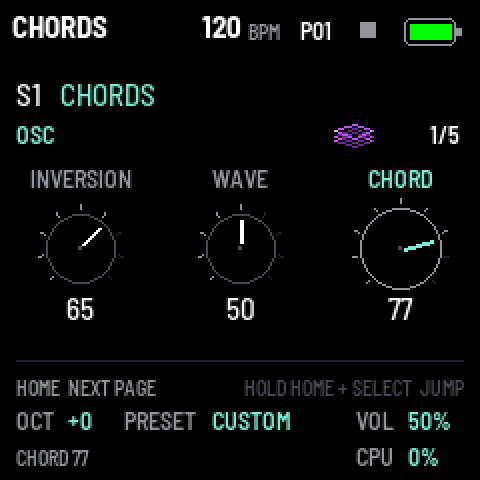
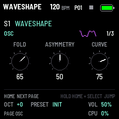
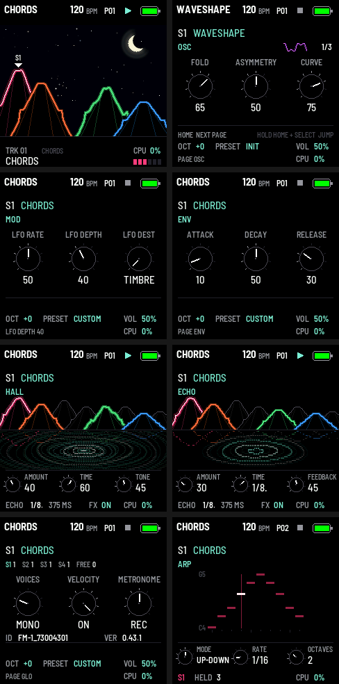

# Terykons

<p align="center"></p>

**A polyphonic synthesizer firmware for the M-VAVE FM-1, on all 24 sound engines of Mutable Instruments' Plaits,
with an echo and the reverb of Mutable Instruments' Beads.**

Up to four voices, each its own engine, played from the FM-1's keys with velocity, over MIDI or by a 64-step
sequencer, shaped by an envelope, moved by an LFO and played through an echo in time with the tempo and Beads'
reverb, all on the FM-1's own panel and screen.

<p align="center"></p>

[Українська версія](README.uk.md) · [The manual](terykons/docs/MANUAL.md)

---

Current version: **0.43.1**: the logo at power-on without the teal sun behind the terricons. 0.43.0: panning: SEL again from the mixer opens PAN, and K1 places the selected track from
full left to full right (L50, C, R50), a pan pot and a left and right meter for each track; the centre sounds as
before. 0.42.2: MULTI's work for the computer runs on the second core, after each block's sound (0.42.1
took 16 % of the first and a heavy patch broke up); its ten inputs at a fixed level with 6 dB of headroom (a hot drum
stays clean), the FM-1 alone on them (not the computer's playback through it). 0.42.1: MULTI for a DAW: the ten
inputs come on the computer's clock (the FM-1's runs 0.045 % fast, and 0.42.0's recordings broke every few seconds),
with a deeper buffer for a busy FM-1, and the computer's sound through the FM-1 as in STEREO. 0.42.0:
multitrack over USB: GLO's USB page (GLO three times), K1 AUDIO at MULTI, and a
computer records the mix on its inputs 1-2 and each of the eight tracks on an input of its own, 3 to 10 (a multitrack
in Ableton, say); STEREO as before. 0.41.1: a chain takes each pattern once, and stopping ends it. 0.41.0: chains: HOME held, several
patterns one after another (1, 2, 3): played in that order, round. 0.40.0: patterns copied, pasted and cleared, as on Elektron's machines: HOME held with OCT-
(copy), OCT+ (paste) or REC (clear). 0.39.0: a MIDI page on GLO (GLO again): each track's MIDI channel (1 to 16, or OFF), IN
(the selected track from any channel, or each track from its own) and CLOCK (OFF, IN, OUT, IN+OUT). 0.38.0: tap tempo: on the TEMPO page (HOME from HOME's terricons) every key taps it, the last
four beats averaged. 0.37.0: each synth track has its own envelope (ENV) and LFO (MOD), part of its sound: a user
preset keeps them, and ATTACK, DECAY, RELEASE, LFO RATE and LFO DEPTH can be locked on a step. 0.36.2: HOME from HOME's
terricons shows TEMPO, SWING and LENGTH as knobs on a page of their own (TEMPO), HOME again the sound's pages. 0.36.1: the logo at power-on stays about two seconds, the version under it. 0.36: GRAV CODE is
Terykons now: its name on the screen, over USB and in the package
(`terykons-0.36.0.fwsc`), and a logo at power-on, five terricons before a teal sun; settings, presets and patterns
carry on as they were. 0.35: parameter locks: EDIT turns on LOCK mode, the white keys the selected track's steps
on every page; hold a step and turn a knob (OSC's, a drum's DRUM and SHAPE, the mixer's VOL and SEND) to lock it on
that step; a step off can lock alone, without a note; recording live, the knobs' moves are recorded as locks. 0.34:
an arpeggiator on ARP, each synth track's, part of its sound: UP, DOWN, UP-DOWN,
RANDOM, AS PLAYED or CHORD, at a note value in time with the song, over 1 to 4 octaves, with GATE and HOLD; the keys,
MIDI in and the sequencer's chord steps play through it. 0.33: the effect's pages show what it does, a lake at night under HOME's terricons: each note
sent into the effect drops a ring, ECHO's repeats follow it in time, HALL's tail ripples on; the knobs small, in the
bottom band. 0.32: the effect is HALL (Beads' reverb, with its TIME, TONE, DIFFUSE and MOD), TAPE (Beads' four media
colouring it) and ECHO (a delay in time with the tempo); Beads' grains, FREEZE and SEED are gone. 0.31: SEQ pressed again shows the selected track alone: a synth track's notes as a piano
roll, a drum track's 64 steps a page a row; a tap on SAVE lights the white keys first to last. 0.30.2: HOME's sky
NIGHT as it comes, by day a light blue one. 0.30: the header names the selected track's engine; step mode's grid
bigger, its bottom band one line. HOME is the song at a glance: a ridge of eight terricons, a track each,
flat-topped, terraced and gullied as the Donbas has them, bending with each track's own sound in its engine's way,
under a sky (GLO's SCREEN, K2 SKY): by day the sun flaring at each kick and clouds drifting at the tempo's pace, by
night a shimmering crescent moon and stars coming and going, flashing at the hi-hats. Step mode's rows in the
tracks' colours, its knobs at the top; every engine's icon a neon picture in its own colour, inside its box. Before
it: 0.27, the presets' browser on PRESET and the mixer's VOL its own fader; 0.26, the mixer on SEL (levels, sends,
mutes, solos); 0.25, recording finished and the colours chosen on GLO; 0.24, live recording. HOME advances pages;
hold HOME and turn SELECT to jump.
[All sound controls](terykons/docs/SOUND_CONTROLS.md).

<p align="center"> </p>

<p align="center"> </p>

## What it does

- **24 engines from Plaits:** virtual analog, waveshaping, 2-operator FM, granular formants, additive, wavetables,
  chords, speech, swarms, filtered noise, particles, inharmonic strings, modal resonators, bass drum, snare, hi-hat,
  and the eight of Plaits 1.2: virtual analog with a filter, phase distortion, three banks of 6-operator FM (DX7
  patches), wave terrains, a string machine and chiptune. Each with Plaits' own TIMBRE, MORPH and HARMONICS, and an
  icon of its own, drawn by code, that moves with them.
- **An effect:** HALL, Beads' reverb (AMOUNT, TIME, TONE, DIFFUSE, MOD); ECHO, a delay in time with the tempo
  (AMOUNT, a note value from 1/32 to 1/2, FEEDBACK); both coloured by Beads' four media (digital to dirty tape). Its
  pages show it as rings on a lake under the terricons.
- **A sequencer of eight tracks:** four synth tracks (S1–S4), each its own engine and sound, voices (the four shared
  out: MONO, POLY or none), and four drum tracks (D1–D4), each a kick, snare or hi-hat of Plaits' (two models each)
  with six knobs (TUNE, DECAY, TONE; the kick's PUNCH, SWEEP, DRIVE), in a voice of its own. Each its steps: 64 in four pages of 16, played on the white keys like a TR, a length of 1 to 64 each
  (polymeters), notes and chords with their velocity and length; sixteen patterns, switched at the pattern's end, chained, copied and pasted;
  the song's tempo (tap it on the TEMPO page's keys), each pattern's swing; step recording, MIDI clock out and in (it follows one); each track's notes
  on its MIDI channel (1–8); parameter locks on the steps (EDIT: LOCK mode), with or without a note, the knobs'
  moves recorded live.
- **An arpeggiator** on each synth track (ARP): six modes, a note value in time, 1–4 octaves, GATE and HOLD; the keys,
  MIDI in and the sequencer's chords through it, its notes out over MIDI; saved with the sound.
- **Polyphony:** up to four voices (POLY), or one with legato (MONO).
- **Velocity** from the FM-1's keys (or a fixed one), pressure sent as polyphonic aftertouch.
- **An envelope** (attack, decay, release) and **an LFO** to TIMBRE, MORPH or pitch on each synth track, saved with
  its sound, lockable on the steps.
- **Settings that stay** across a power cycle and a firmware update.
- **MIDI** in over USB and TRS, out over USB, each track on a channel of its choosing (GLO's MIDI page); the FM-1 is
  also a **USB sound card**: the mix in stereo, or (MULTI, GLO's USB page) the mix and each track on its own input
  (on a Mac, the DAW's Mic Mode Standard, not Voice Isolation: the manual, section 10).
- **Two-core voice rendering** and a **DEBUG page** showing average/peak load, worker timing, audio xruns and voice cuts.
- **A web installer** (Chrome or Edge), and the stock firmware back from the same page.

## The screen and its pages

<p align="center"></p>

<p align="center"></p>

| Button | Page | K1 | K2 | K3 |
| --- | --- | --- | --- | --- |
| HOME | HOME (the terricons) | TEMPO (30 to 300 BPM) | SWING (50 to 75 %) | LENGTH (1 to 64 steps) |
| HOME again | TEMPO (its knobs shown; any key taps the tempo) | TEMPO | SWING | LENGTH |
| HOME again | OSC | TIMBRE | MORPH | HARMONICS |
| LFO | MOD (the synth track's) | LFO RATE (0.05 to 20 Hz) | LFO DEPTH | LFO DEST (TIMBRE, MORPH, PITCH) |
| ENV | ENV (the synth track's) | ATTACK (0 to 2 s) | DECAY (0 to 2 s, to 70 %) | RELEASE (0 to 4 s) |
| GLO | GLO | VOICES, the track's (OFF, MONO, 2, 3, 4; four in all) | VELOCITY (ON, OFF) | METRONOME (OFF, REC, COUNT) |
| GLO again | MIDI | CHANNEL: the track's (OFF, 1 to 16) | IN (SELECTED, CHANNELS) | CLOCK (OFF, IN, OUT, IN+OUT) |
| GLO again | USB | AUDIO: STEREO (the mix on 1-2, the computer's sound through the FM-1) or MULTI (the mix on 1-2, each track on its own input, 3 to 10) | — | — |
| GLO again | SCREEN | THEME: the screen's colours (TEAL, AMBER, CYAN, ICE, GREEN, LIME, VIOLET, PINK, RED, MONO) | SKY: HOME's sky (OFF, DAY, NIGHT) | — |
| FX | HALL | AMOUNT (into the reverb) | TIME (the tail) | TONE (dark to bright) |
| FX again | TAPE | QUALITY (DIGITAL, VINTAGE, CLEAN TAPE, DIRTY TAPE) | DIFFUSE | MOD (the tail's movement) |
| FX again | ECHO | AMOUNT (into the echo) | TIME (1/32 to 1/2, triplets and dotted, at the tempo) | FEEDBACK |
| ARP | ARP | MODE (OFF, UP, DOWN, UP-DOWN, RANDOM, AS PLAYED, CHORD) | RATE (1/32 to 1/2, at the tempo) | OCTAVES (1 to 4) |
| ARP again | ARP 2 | GATE (5 to 100 %) | HOLD (OFF, ON) | — |
| GLO again | DEBUG | one/two cores | reset peaks/counters | — |
| SEL | MIXER | VOL (the selected track's fader) | SEND (its share through the effect) | RETURN (HALL's AMOUNT); white keys 1–8 mute the tracks, black keys 1–8 solo them |
| SEL again | PAN | PAN: the selected track's place (L50 to C to R50) | — | —; the keys mute and solo, as on the mixer |

SELECT picks the track (S1–S4, D1–D4) the keys, ALGO, PRESET, OSC, VOICES and the steps are for; ALGO picks its
engine (on a drum track: bass drum, snare, hi-hat), OCT- and OCT+ the octave (-2 to +2), MASTER the volume, SAVE
stores the settings and pattern, EDIT turns LOCK mode on and off (parameter locks). Sound pages include the engine's extra controls and OUTPUT (tune, level, AUX mix);
PRESET browses four factory sounds and the user presets for this engine.
Hold SAVE for the 64 user slots (four pages, OCT-/+); a white key saves or replaces that slot. A queued preset
is written after stopping and releasing the notes; wait for PRESET SAVED before powering off. SEQ turns step mode on (the white keys are the steps; hold one and turn K1..K3 for its note,
velocity, length; the black keys 1–8 the tracks; OCT- / OCT+ the pages; SEQ held and a step: the length; SEQ again:
the selected track alone, a synth track's notes as a piano roll, a drum's 64 steps; a third time: out), PLAY
starts and stops, REC (stopped) records notes and chords step by step. HOME held and a white key, or K4, picks the
pattern (playing: at the pattern's end). The open page's button blinks, faster on its next page; PLAY flashes green on the beat. SEL opens
the mixer from every page, again PAN (each track's place from left to right), again back. The effect takes nothing in with both AMOUNTs at 0; once its tails have died away it is
off, and costs nothing then.

DEBUG keeps two-core mode on by default. Its controls are temporary and are not saved. Heavy FX settings can
still trigger voice cuts above 90% of an audio block; the smoothed CPU meter can hide short peaks. See
[the measured results](terykons/docs/DUAL_CORE_RESULTS.md) and [the debug guide](terykons/docs/DUAL_CORE_DEBUG.md).

## The engines

K1 TIMBRE, K2 MORPH, K3 HARMONICS (shown with engine-specific names); in ALGO's order (Plaits' own):

| # | Engine | TIMBRE | MORPH | HARMONICS |
| --- | --- | --- | --- | --- |
| 1 | ANALOG | Pulse to square to sync | Triangle to saw to notch | Detune |
| 2 | WAVESHAPE | Folding | Asymmetry | Shaper curve |
| 3 | FM 2-OP | Index | Feedback | Ratio |
| 4 | GRAIN | Formant | Formant width | Formant ratio |
| 5 | ADDITIVE | Strongest harmonic | Bump shape | Number of bumps |
| 6 | WAVETABLE | Row | Column | Bank |
| 7 | CHORDS | Inversion | Waveform | Chord |
| 8 | SPEECH | Species | Phoneme or word part | Vowels, then words |
| 9 | SWARM | Density | Grain length | Pitch randomness |
| 10 | NOISE | Clock | Resonance | Low, band, high-pass |
| 11 | PARTICLE | Density | Reverb to band-pass | Randomness |
| 12 | STRING | Excitation | Decay | Material |
| 13 | MODAL | Excitation | Decay | Material |
| 14 | BASS DRUM | Brightness | Decay | Attack, overdrive |
| 15 | SNARE | Drum modes | Decay | Tone against noise |
| 16 | HI-HAT | High-pass | Decay | Metal against noise |
| 17 | VA VCF | Cutoff | Waveform, sub | Resonance |
| 18 | PHASE DIST | Amount | Asymmetry | Frequency |
| 19 | 6-OP FM 1 | Brightness | Envelope stretch | Patch: basses, synths |
| 20 | 6-OP FM 2 | Brightness | Envelope stretch | Patch: keys, plucks, percussion |
| 21 | 6-OP FM 3 | Brightness | Envelope stretch | Patch: organs, pads, strings, brass |
| 22 | TERRAIN | Path radius | Path offset | Terrain |
| 23 | STRING MCH | Chorus, filter | Waveform | Chord |
| 24 | CHIPTUNE | Arpeggio | Pulse width, sync | Chord |

A note plays an engine as Plaits' trigger would: most engines sound while the note is held; STRING and MODAL are
struck, then keep sounding; the drums, the 6-OP FM banks, SPEECH's words and PARTICLE take each note as a gate. The
manual has the details: [terykons/docs/MANUAL.md](terykons/docs/MANUAL.md).

## Install

1. Build or download the package, `terykons-VERSION.fwsc`.
2. Make the site and serve it (or use the published one):

   ```bash
   python3 tools/make_site.py terykons terykons/build/terykons-0.43.1.fwsc 0.43.1 terykons/build/site
   python3 -m http.server 8080 --directory terykons/build/site
   ```

3. In Chrome or Edge, open `http://localhost:8080/install/`, connect the FM-1 by USB and press Install.

The same page writes M-VAVE's stock firmware back. Installing is at your own risk.

## Build

Terykons builds with fm1-base's `tools/build.py`: JieLi's toolchain (Linux x86-64; on macOS it runs in Docker) and
JieLi's AC79 SDK.

```bash
export JIELI_TOOLCHAIN="$HOME/.jieli/toolchain" AC79_SDK="$HOME/fw-AC79_AIoT_SDK"
python3 tools/build.py terykons --release 0.43.1      # terykons/build/terykons-0.43.1.fwsc
python3 tools/build.py terykons --host                # the simulator, for the tests:
terykons/build/host/terykons_host terykons/tests/basic.txt terykons/build/host
python3 tools/build.py terykons --web                 # the browser emulator (Emscripten)
```

The tests (`terykons/tests/`): `basic.txt` (keys, octave, saving, MIDI), `engines.txt` (every engine plays),
`voices.txt` (polyphony, MONO, velocity), `fx.txt` (the effect: HALL, TAPE, ECHO, its lake, saving, older settings), `arp.txt` (the arpeggiator), `locks.txt` (parameter locks), `envlfo.txt` (each synth track's ENV and LFO), `tap.txt` (tap tempo), `midi.txt` (GLO's MIDI page: channels, IN, CLOCK), `usb.txt` (GLO's USB page: STEREO, MULTI, each track on its input), `copy.txt` (patterns copied, pasted, cleared), `chain.txt` (chains),
`dual_core.txt` (DEBUG and worker scheduling), `seq.txt` (the sequencer), `rec.txt` (live recording, the metronome), `theme.txt` (the screen's colours), `mixer.txt` (the mixer), `pan.txt` (PAN: each side, saving, older settings), `browser.txt` (HOME's terricons, the presets' browser), `playback.txt` (all eight tracks playing, VOICES shared out), `tracks.txt` (the synth tracks), `drums.txt` (the drum tracks), `patterns.txt` (the patterns), `icons.txt` (the icons), `presets.txt` (browsing, saving, reboot and deferred/error writes), `sound_pages.txt` (advanced controls, all six FM operators, animation and migration), `seq_test.c` (its timing, to the sample, and
`bank_test.c`, the patterns' flash: `run_seq_test.py`), `screens.txt` (the screenshots). More in
[terykons/README.md](terykons/README.md).

## The repository

| Path | What |
| --- | --- |
| `terykons/` | Terykons: the app (`app.c`), its DSP (`dsp/`: Plaits' engines per voice, the effect, the mixer), its voices and modulation (`synth/`), the sequencer (`seq/`), Plaits, Beads' reverb and the other vendored code (`vendor/`), tests, docs, the site's page |
| `device/`, `include/`, `lib/`, `host/`, `web/`, `tools/` | fm1-base: the FM-1 platform, the simulator, the emulator, the installer, the build ([FM1-BASE.md](FM1-BASE.md)) |
| `bsp/` | felucca-bsp: the FM-1's chip and board support |
| `template/`, `tests/`, `ble/` | fm1-base's reference app and its platform tests, its Bluetooth stack (not built into Terykons) |

## Credits and licences

- Built on **fm1-base** by Charles Vestal and **felucca-bsp** by Leo Kuroshita (Hügelton Instruments), MPL-2.0;
  see [CREDITS.md](CREDITS.md) and [LICENSING.md](LICENSING.md).
- Sound engines: **Mutable Instruments Plaits**; reverb and tape: **Mutable Instruments Beads**; their library **stmlib**; by
  Émilie Gillet, MIT License ([terykons/vendor/plaits/LICENSE](terykons/vendor/plaits/LICENSE),
  [terykons/vendor/beads/LICENSE](terykons/vendor/beads/LICENSE)); what else is vendored and under which licence:
  [terykons/vendor/README.md](terykons/vendor/README.md).
- Terykons' own code: MPL-2.0.

M-VAVE and FM-1 are trademarks of their owners. Terykons is not affiliated with M-VAVE or Mutable Instruments.
