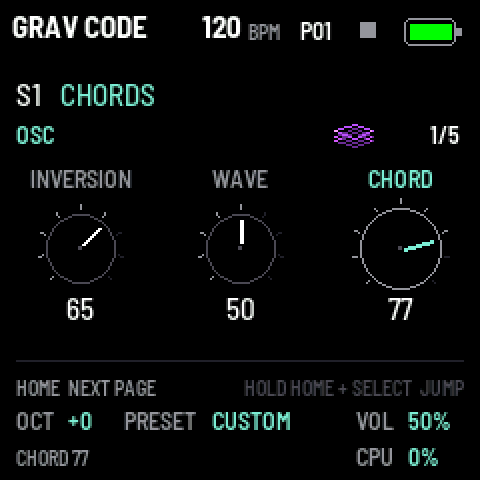
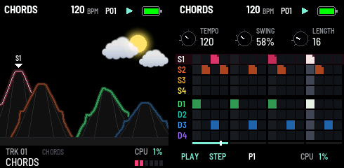
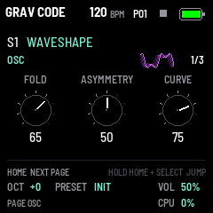
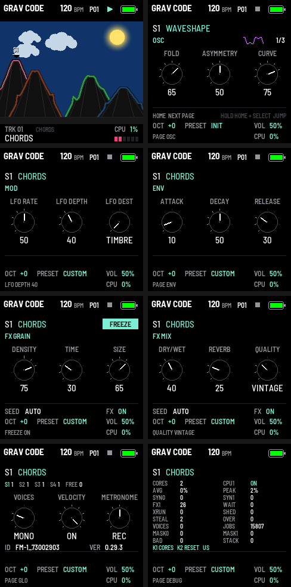
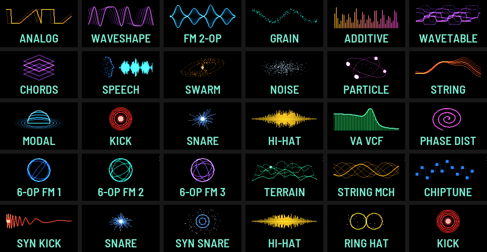

# GRAV CODE

**Полифоническая прошивка-синтезатор для M-VAVE FM-1 на всех 24 звуковых движках Mutable Instruments Plaits,
с эффектом Mutable Instruments Beads.**

До четырёх голосов, у каждого свой движок. Играется с клавиш FM-1 с учётом силы нажатия или по MIDI, звук формирует
огибающая, движение даёт LFO, а дальше он идёт через гранулы, задержку и реверб Beads. Всё управляется с панели и
экрана самого FM-1.

<p align="center"></p>

[English](README.md) · [Мануал (на английском)](grav-code/docs/MANUAL.md)

---

Текущая версия: **0.29.3** (облака ниже и пышнее, чистый месяц, иконки движков целиком в своих рамках; 0.29.2:
ровное небо, сцена HOME выше, нижняя полоса меньше; 0.29.1: ночь ожила: луна справа переливается, звёзды гаснут и
зажигаются; днём терриконы тёмные; уровень в нижней полосе), на основе 0.29.0, небо над HOME: днём голубое, солнце
вспыхивает на бочке, облака плывут в темпе; ночью луна и звёзды, мерцающие на хэтах (GLO, страница SCREEN, K2 SKY:
OFF, DAY, NIGHT); терриконы как в Донбассе — усечённые вершины, террасы, промоины. Ручки шагового режима вверху
страницы. До этого: 0.28 — гряда из восьми терриконов на HOME, по террикону на дорожку, склоны изгибаются от звука
своей дорожки по-своему для каждого движка, ряды шагового режима в тех же цветах, иконки всех движков перерисованы
неоновыми картинками; 0.27 — браузер пресетов на PRESET и VOL в микшере — свой фейдер (0.27.1: VOICES больше не
глушит другие дорожки; 0.27.2: код почищен); 0.26 — микшер на SEL (громкость, посылы, мьют, соло); 0.25 — доводка
записи и выбор цветов на GLO; 0.24 — живая запись. HOME листает страницы; HOME зажат + SELECT переключает их быстро.
[Все параметры и управление](grav-code/docs/SOUND_CONTROLS.md).

<p align="center"> </p>

## Возможности

- **24 движка Plaits:** виртуальный аналог, вейвшейпинг, двухоператорный FM, гранулярные форманты, аддитивный синтез,
  волновые таблицы, аккорды, речь, «рой» осцилляторов, фильтрованный шум, частицы, неоднородная струна, модальный
  резонатор, бочка, малый барабан, хай-хэт, а также восемь движков Plaits 1.2: аналог с фильтром, фазовое искажение,
  три банка шестиоператорного FM (патчи DX7), волновые ландшафты, струнная машина и чиптюн. У каждого свои TIMBRE,
  MORPH и HARMONICS, как на Plaits, и своя иконка, нарисованная кодом, которая двигается вместе с ними.
- **Эффект Beads:** гранулярный процессор (DENSITY, TIME, SIZE, SHAPE, PITCH, FEEDBACK), задержка, четыре качества
  записи (от чистого цифрового до «грязной» ленты) и реверб; FREEZE и SEED на кнопках панели.
- **Секвенсор на восемь дорожек:** четыре синтовые (S1–S4), у каждой свой движок и звук, голоса (четыре на всех:
  MONO, POLY или ни одного), и четыре барабанные (D1–D4): кик, малый или хай-хэт Plaits (по две модели) с шестью
  ручками (TUNE, DECAY, TONE; у кика PUNCH, SWEEP, DRIVE), у каждой свой голос. У каждой дорожки свои шаги — 64, четыре страницы по 16 на белых клавишах, как у TR; своя длина от 1 до 64
  (полиметрия); ноты и аккорды со своей силой и длиной; шестнадцать паттернов, смена в конце паттерна; общий темп,
  свой свинг у паттерна; пошаговая запись; MIDI clock на выход и вход; ноты каждой дорожки на своём MIDI-канале (1–8).
- **Полифония:** до четырёх голосов (POLY) или один с легато (MONO).
- **Velocity** с клавиш FM-1 (или фиксированная), давление клавиш уходит по MIDI как полифоническое послекасание.
- **Огибающая** (атака, спад, затухание) и **LFO** на TIMBRE, MORPH или высоту тона.
- **Настройки сохраняются** после выключения и обновления прошивки.
- **MIDI:** вход по USB и TRS, выход по USB; FM-1 работает и как **USB-звуковая карта**.
- **Расчёт голосов на двух ядрах** и **страница DEBUG**: средняя и пиковая нагрузка, время обработки, пропуски аудио и отключения голосов.
- **Установка из браузера** (Chrome или Edge), с той же страницы можно вернуть заводскую прошивку.

## Экран и страницы

<p align="center"></p>

<p align="center"></p>

| Кнопка | Страница | K1 | K2 | K3 |
| --- | --- | --- | --- | --- |
| HOME | HOME (терриконы) | TEMPO (30–300 BPM) | SWING (50–75 %) | LENGTH (1–64 шага) |
| HOME ещё раз | OSC | TIMBRE | MORPH | HARMONICS |
| LFO | MOD | LFO RATE (0,05–20 Гц) | LFO DEPTH (глубина) | LFO DEST (TIMBRE, MORPH, PITCH) |
| ENV | ENV | ATTACK (0–2 с) | DECAY (0–2 с, до 70 %) | RELEASE (0–4 с) |
| GLO | GLO | VOICES дорожки (OFF, MONO, 2, 3, 4; всего четыре) | VELOCITY (ON, OFF) | METRONOME (OFF, REC, COUNT) |
| GLO ещё раз | SCREEN | THEME: цвета экрана (TEAL, AMBER, CYAN, ICE, GREEN, LIME, VIOLET, PINK, RED, MONO) | SKY: небо HOME (OFF, DAY, NIGHT) | — |
| FX | FX MIX | DRY/WET | REVERB | QUALITY (DIGITAL, VINTAGE, CLEAN TAPE, DIRTY TAPE) |
| FX ещё раз | FX GRAIN | DENSITY (в середине гранул нет: левее — ровно по такту, правее — случайно) | TIME (насколько далеко назад) | SIZE (назад, вперёд, в конце — задержка) |
| FX ещё раз | FX SHAPE | SHAPE (огибающая гранулы) | PITCH (от -24 до +24 полутонов) | FEEDBACK (обратная связь) |
| GLO ещё раз | DEBUG | одно/два ядра | сброс пиков и счётчиков | — |
| SEL | MIXER | VOL (фейдер выбранной дорожки) | SEND (доля в эффект) | RETURN (DRY/WET эффекта); белые клавиши 1–8 — мьют дорожек, чёрные 1–8 — соло |

SELECT выбирает дорожку (S1–S4, D1–D4), для неё работают клавиши, ALGO, PRESET, OSC, VOICES и шаги. Ручка ALGO
выбирает её движок (на барабанной дорожке: бочка, малый барабан, хай-хэт), OCT- и OCT+ — октаву (от -2 до +2),
MASTER — громкость, короткий SAVE сохраняет настройки и паттерн. PRESET перебирает четыре заводских звука
и пользовательские пресеты этого движка. HOME открывает дополнительные страницы и OUTPUT (строй, уровень, AUX);
удержание HOME + поворот SELECT быстро выбирает страницу. Удержание SAVE открывает 64 ячейки (четыре страницы, OCT-/+); белая
клавиша сохраняет или заменяет ячейку. Запись ждёт остановки и отпускания нот; перед выключением дождись
PRESET SAVED. SEQ включает режим шагов (белые клавиши — шаги;
зажал шаг и крутишь K1..K3 — его нота, сила, длина; чёрные клавиши 1–8 — дорожки; OCT- / OCT+ — страницы; SEQ
зажат + шаг — длина), PLAY запускает и останавливает, REC (на стопе) записывает ноты и аккорды по шагу. HOME зажат +
белая клавиша или ручка K4 — паттерн (при игре — в конце текущего). Кнопка открытой страницы мигает, на следующей её
странице быстрее; PLAY мигает зелёным в долю. EDIT
замораживает запись эффекта (FREEZE); SEL открывает микшер с любой страницы, а зажатый на странице FX запускает гранулы вручную
(держать ещё 2 с — гранулы снова идут сами: SEED). При DRY/WET и REVERB на 0 эффект выключен и не тратит процессор.

По умолчанию работают два ядра. Переключение режима в DEBUG временное, через SAVE оно не сохраняется.
При тяжёлых настройках FX защита всё ещё может отключать голоса на пиках выше 90% времени аудиоблока,
даже когда средний CPU ниже. См. [результаты замеров](grav-code/docs/DUAL_CORE_RESULTS.md) и
[описание DEBUG](grav-code/docs/DUAL_CORE_DEBUG.md).

## Движки

K1 — TIMBRE, K2 — MORPH, K3 — HARMONICS (на экране — свои названия для движка); в порядке ручки ALGO (как на Plaits):

| # | Движок | TIMBRE | MORPH | HARMONICS |
| --- | --- | --- | --- | --- |
| 1 | ANALOG | Импульс → меандр → синхронизация | Треугольник → пила → вырез | Расстройка |
| 2 | WAVESHAPE | Складывание волны | Асимметрия | Кривая шейпера |
| 3 | FM 2-OP | Индекс модуляции | Обратная связь | Соотношение частот |
| 4 | GRAIN | Частота форманты | Ширина форманты | Соотношение формант |
| 5 | ADDITIVE | Самая сильная гармоника | Форма «горбов» спектра | Число «горбов» |
| 6 | WAVETABLE | Строка таблицы | Столбец | Банк |
| 7 | CHORDS | Обращение | Форма волны | Тип аккорда |
| 8 | SPEECH | «Голос» (от великана до бурундука) | Фонема или часть слова | Гласные, затем слова |
| 9 | SWARM | Плотность | Длина гранул | Разброс высоты |
| 10 | NOISE | Тактовая частота | Резонанс | ФНЧ → полосовой → ФВЧ |
| 11 | PARTICLE | Плотность частиц | Реверб → резонансный полосовой | Разброс частот |
| 12 | STRING | Яркость возбуждения | Затухание | Материал |
| 13 | MODAL | Яркость возбуждения | Затухание | Материал |
| 14 | BASS DRUM | Яркость | Затухание | Атака и перегруз |
| 15 | SNARE | Баланс мод барабана | Затухание | Тон против шума |
| 16 | HI-HAT | Срез ФВЧ | Затухание | Металл против шума |
| 17 | VA VCF | Срез фильтра | Форма волны и саб | Резонанс |
| 18 | PHASE DIST | Глубина искажения | Асимметрия | Частота искажения |
| 19 | 6-OP FM 1 | Яркость | Растяжение огибающих | Патч: басы, синты |
| 20 | 6-OP FM 2 | Яркость | Растяжение огибающих | Патч: клавишные, щипковые, перкуссия |
| 21 | 6-OP FM 3 | Яркость | Растяжение огибающих | Патч: органы, пэды, струнные, медь |
| 22 | TERRAIN | Радиус пути | Смещение пути | Ландшафт |
| 23 | STRING MCH | Хорус и фильтр | Форма волны | Аккорд |
| 24 | CHIPTUNE | Арпеджио | Ширина импульса, синхронизация | Аккорд |

Нота работает как триггер Plaits. Большинство движков звучат, пока нота зажата. STRING и MODAL получают удар и
звучат дальше, пока держишь клавишу. Ударные, банки 6-OP FM, слова SPEECH и PARTICLE воспринимают ноту как гейт.
Подробности — в [мануале](grav-code/docs/MANUAL.md).

## Установка

1. Соберите или скачайте пакет `grav_code-ВЕРСИЯ.fwsc`.
2. Соберите сайт и запустите его (или используйте опубликованный):

   ```bash
   python3 tools/make_site.py grav-code grav-code/build/grav_code-0.29.3.fwsc 0.29.3 grav-code/build/site
   python3 -m http.server 8080 --directory grav-code/build/site
   ```

3. В Chrome или Edge откройте `http://localhost:8080/install/`, подключите FM-1 по USB и нажмите Install.

С той же страницы можно вернуть заводскую прошивку M-VAVE. Установка — на ваш страх и риск.

## Сборка

GRAV CODE собирается инструментом fm1-base `tools/build.py`: нужен тулчейн JieLi (Linux x86-64; на macOS он
запускается в Docker) и AC79 SDK от JieLi.

```bash
export JIELI_TOOLCHAIN="$HOME/.jieli/toolchain" AC79_SDK="$HOME/fw-AC79_AIoT_SDK"
python3 tools/build.py grav-code --release 0.29.3      # grav-code/build/grav_code-0.29.3.fwsc
python3 tools/build.py grav-code --host                # симулятор для тестов:
grav-code/build/host/grav_code_host grav-code/tests/basic.txt grav-code/build/host
python3 tools/build.py grav-code --web                 # эмулятор в браузере (Emscripten)
```

Тесты (`grav-code/tests/`): `basic.txt` (клавиши, октава, сохранение, MIDI), `engines.txt` (все движки звучат),
`voices.txt` (полифония, MONO, velocity), `fx.txt` (эффект: страницы, FREEZE, SEED, QUALITY, сохранение),
`seq.txt` (секвенсор), `rec.txt` (живая запись, метроном), `theme.txt` (цвета экрана), `mixer.txt` (микшер), `browser.txt` (терриконы HOME, браузер пресетов), `playback.txt` (все восемь дорожек играют, раздача голосов VOICES), `tracks.txt` (синтовые дорожки), `drums.txt` (барабанные дорожки), `patterns.txt` (паттерны), `icons.txt` (иконки), `seq_test.c` (его тайминг до сэмпла) и `bank_test.c`
(паттерны во флеше): `run_seq_test.py`, `screens.txt` (скриншоты). Подробнее — в
[grav-code/README.md](grav-code/README.md).

## Что где лежит

| Путь | Что |
| --- | --- |
| `grav-code/` | Сама прошивка: приложение (`app.c`), DSP (`dsp/`: движки Plaits по голосам, Beads, микшер), голоса и модуляция (`synth/`), Plaits, Beads и прочий сторонний код (`vendor/`), тесты, документация, страница сайта |
| `device/`, `include/`, `lib/`, `host/`, `web/`, `tools/` | Платформа fm1-base: работа с FM-1, симулятор, эмулятор, установщик, сборка ([FM1-BASE.md](FM1-BASE.md)) |
| `bsp/` | felucca-bsp: поддержка чипа и платы FM-1 |
| `template/`, `tests/`, `ble/` | Эталонное приложение fm1-base и тесты платформы, стек Bluetooth (в GRAV CODE не собирается) |

## Авторы и лицензии

- Основа: **fm1-base** (Charles Vestal) и **felucca-bsp** (Leo Kuroshita, Hügelton Instruments), MPL-2.0; см.
  [CREDITS.md](CREDITS.md) и [LICENSING.md](LICENSING.md).
- Звуковые движки — **Mutable Instruments Plaits**, эффект — **Mutable Instruments Beads**, их библиотека —
  **stmlib**; автор — Émilie Gillet, лицензия MIT ([grav-code/vendor/plaits/LICENSE](grav-code/vendor/plaits/LICENSE),
  [grav-code/vendor/beads/LICENSE](grav-code/vendor/beads/LICENSE)); что ещё взято со стороны и под какими
  лицензиями — [grav-code/vendor/README.md](grav-code/vendor/README.md).
- Собственный код GRAV CODE — MPL-2.0.

M-VAVE и FM-1 — товарные знаки их владельцев. GRAV CODE не связан с M-VAVE и Mutable Instruments.
