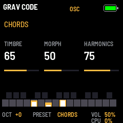
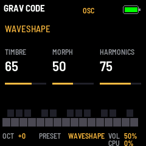
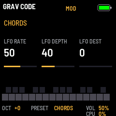
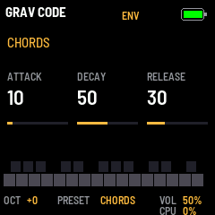
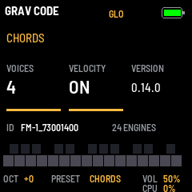
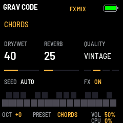
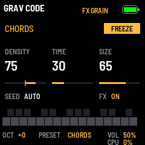
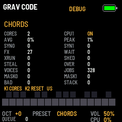

# GRAV CODE

GRAV CODE turns the M-VAVE FM-1 into a polyphonic synthesizer on all 24 sound engines of Mutable Instruments'
Plaits, through the granular processor, delay and reverb of Mutable Instruments' Beads: up to four voices, each its
own engine, played from the keys with velocity or over MIDI, shaped by an envelope and moved by an LFO. Everything
is on the FM-1's own panel and screen; the settings stay across a power cycle.

---

## Contents

1. Install
2. The screen
3. Controls
4. The pages
5. The engines
6. The effect (FX)
7. Voices and velocity
8. Saving
9. MIDI and USB audio
10. CPU and its limits
11. Troubleshooting
12. Credits and licences

---

## 1. Install

**Try it first:** the emulator on the site runs the same code in the browser, with sound, played with the mouse, a
touch screen or the computer keyboard.

**Install from the browser:** in Chrome or Edge, connect the FM-1 by USB (a data cable), open the installer and
press Install. The browser asks once to allow MIDI: allow it. Don't unplug the cable while it writes; the FM-1
restarts into GRAV CODE when it is done. Coming from another firmware, leave it running as it is: no update mode is
needed.

**Install from a terminal:** `python3 tools/fm1_install.py grav_code-VERSION.fwsc` (it needs Python's `mido` and
`python-rtmidi`).

**Back to the stock firmware:** the installer's last section writes M-VAVE's own firmware back. Installing is at
your own risk.

---

## 2. The screen

From the top:

- **The header:** GRAV CODE, the page you are on (OSC, MOD, ENV, GLO, FX GRAIN, FX SHAPE, FX MIX or DEBUG), and the
  battery: three bars, green when full, yellow, then red; a lightning bolt while the FM-1 runs on USB power.
- **The engine** that plays, by its name; beside it FREEZE, lit, while the effect is frozen.
- **The page's three parameters**, each with its value (0 to 100) and a bar: K1, K2 and K3 change them. A bar that
  starts from a mark in the middle (DENSITY, PITCH) has its rest there.
- **The keyboard:** a key held fills to its velocity (amber) and, pressed further, to its pressure (white).
- **The bottom lines:** OCT (the octave), PRESET (the engine), VOL (MASTER), and when MIDI has come in, the last
  message and where from (USB or TRS). CPU is the share of its time the sound takes: it turns red once a block of
  sound came late (heard as a crackle), until the next power-on.

---

## 3. Controls

| Control | What it does |
| --- | --- |
| Keys | Play, with velocity (or a fixed one: GLO). 27 keys, F3 to G5 at OCT +0 |
| OCT- / OCT+ | The octave, -2 to +2. Keys held keep their notes until they are let go |
| PRESET (knob) | The engine: all 24 in Plaits' order, round from the last to the first |
| K1, K2, K3 | The page's three parameters (the GLO page: its settings) |
| HOME | The OSC page: TIMBRE, MORPH, HARMONICS |
| LFO | The MOD page: LFO RATE, LFO DEPTH, LFO DEST |
| ENV | The ENV page: ATTACK, DECAY, RELEASE |
| GLO | The GLO page: VOICES, VELOCITY, the version |
| FX | The effect's pages, again for the next: FX GRAIN, FX SHAPE, FX MIX. Lit while the effect runs |
| EDIT | FREEZE: the effect's recording held, or let go. Lit while frozen |
| SEL | SEED: a grain by hand; held 2 s, the grains on their own again. Lit while they come on their own |
| REC | DEBUG: K1 selects one/two-core processing; K2 resets peaks and counters |
| MASTER | The volume, glided: no step in the sound |
| SAVE | Stores the settings; lit while there are changes not stored |

The other buttons (ARP, SEQ, PLAY) and knobs (SELECT, ALGO, K4) only say their name or count for now: they are
free for what comes next.

**At power-on:** OCT- and OCT+ held is the panel's setup (the knobs' and keys' calibration); REC held starts the
chip's update mode, a way to install when GRAV CODE starts but its USB can't be reached.

---

## 4. The pages

### OSC (HOME)

The engine's own three parameters, as on Plaits: **TIMBRE** (K1), **MORPH** (K2) and **HARMONICS** (K3). What each
does depends on the engine: section 5. They start at 65, 50 and 75.

### MOD (LFO)

One sine LFO for all the voices, free-running (a note doesn't restart it):

| Knob | Parameter | Range |
| --- | --- | --- |
| K1 | LFO RATE | 0.05 Hz to 20 Hz (50: 10 Hz) |
| K2 | LFO DEPTH | 0 (off) to 100 |
| K3 | LFO DEST | 0 to 33: TIMBRE; 34 to 67: MORPH; 68 to 100: PITCH |

At full depth it sweeps TIMBRE or MORPH by half their range either side of the knob, or the pitch by 2 semitones
either side. It starts at RATE 50, DEPTH 0 (off).

### ENV (ENV)

Each voice's envelope, which shapes its level:

| Knob | Parameter | Range |
| --- | --- | --- |
| K1 | ATTACK | 0 to 2 s |
| K2 | DECAY | 0 to 2 s, down to a sustain of 70 % |
| K3 | RELEASE | 0 to 4 s, after the key is let go |

It starts at ATTACK 10 (0.2 s), DECAY 50 (1 s) and RELEASE 30 (1.2 s).

> The engines with an envelope of their own play through it, as Plaits' low-pass gate lets them: BASS DRUM, SNARE,
> HI-HAT, the three 6-OP FM banks (each patch's envelopes), and SPEECH while it speaks a word.

### GLO (GLO)

The firmware and its global settings:

| Knob | Setting | Values |
| --- | --- | --- |
| K1 | VOICES | MONO, 2, 3, 4 (the default) |
| K2 | VELOCITY | ON (right: the keys play as they land), OFF (left: at a fixed 100) |
| K3 | VERSION | the firmware's version, said aloud |

Under them, the package's identity (the installer's) and the number of engines. Section 7 has more on both settings.

### FX GRAIN, FX SHAPE, FX MIX (FX)

The effect's three pages: section 6.

---

## 5. The engines

PRESET steps through all 24 engines of Plaits, in Plaits' own order: its first sixteen, then the eight its firmware
1.2 added. K1 is TIMBRE, K2 MORPH, K3 HARMONICS; what they do, engine by engine:

| # | Engine | TIMBRE (K1) | MORPH (K2) | HARMONICS (K3) |
| --- | --- | --- | --- | --- |
| 1 | ANALOG | Square: narrow pulse, square, then hard-sync formants | Saw: triangle to saw, then a widening notch | Detune between the two waves |
| 2 | WAVESHAPE | Wavefolding | Asymmetry | The shaper's curve |
| 3 | FM 2-OP | Modulation index | Feedback: rough one way, chaotic the other | Frequency ratio |
| 4 | GRAIN | Formant frequency | Formant width and shape | Ratio between the two formants |
| 5 | ADDITIVE | Which harmonic is strongest | Shape of the bumps, wide to narrow | Number of bumps in the spectrum |
| 6 | WAVETABLE | Row in the table | Column | Bank: four smooth, then four stepped |
| 7 | CHORDS | Inversion and transposition | Waveform: string and organ, then a wavetable | Chord type |
| 8 | SPEECH | Species: the formants, from giant to chipmunk | Phoneme, or the part of the word | Vowels (formant, SAM, LPC), then banks of words |
| 9 | SWARM | Density of the grains | Grain length and overlap | Pitch randomness |
| 10 | NOISE | Clock frequency | Resonance | Filter: low-pass, band-pass, high-pass |
| 11 | PARTICLE | Density of the particles | Filter: an all-pass reverb, then resonant band-pass | Frequency randomness |
| 12 | STRING | Brightness of the excitation | Decay | Inharmonicity, the material |
| 13 | MODAL | Brightness of the excitation | Decay | Inharmonicity, the material |
| 14 | BASS DRUM | Brightness | Decay | Attack sharpness and overdrive |
| 15 | SNARE | Balance of the drum's modes | Decay | Tone against noise |
| 16 | HI-HAT | High-pass cutoff | Decay | Metal against noise |
| 17 | VA VCF | Filter cutoff | Waveform and sub level | Resonance and character, smooth to harsh |
| 18 | PHASE DIST | Amount of distortion | Its asymmetry | Its frequency |
| 19 | 6-OP FM 1 | Brightness (the modulators' level) | Envelopes and modulation, stretched | One of 32 patches: basses and synths |
| 20 | 6-OP FM 2 | Brightness | Envelopes and modulation, stretched | One of 32 patches: keys, plucks, percussion |
| 21 | 6-OP FM 3 | Brightness | Envelopes and modulation, stretched | One of 32 patches: organs, pads, strings, brass |
| 22 | TERRAIN | Radius of the path | Offset of the path | One of eight terrains, blended |
| 23 | STRING MCH | Chorus and filter | Waveform | Chord |
| 24 | CHIPTUNE | Arpeggio, or the chord's inversion | Pulse width and sync | Chord |

### How a note plays each engine

Plaits has a trigger input; in GRAV CODE a note is the trigger, in three ways:

- **Held:** most engines simply sound for as long as the note is held, and the envelope shapes them.
- **Struck, then sounding on:** STRING and MODAL are struck when a note begins and kept ringing while it is held
  (as on Plaits with nothing in its trigger input), then ring out with the envelope's release.
- **A gate:** BASS DRUM, SNARE and HI-HAT are struck by each note and decay on their own; the 6-OP FM banks play
  their patch's envelopes, which release when the key is let go; SPEECH speaks a word with each note when HARMONICS
  is among the word banks; PARTICLE starts afresh with each note.

The velocity is also Plaits' accent: the engines that strike strike harder and brighter. Plaits' second output
(AUX) is not used. The engines run as on Plaits, 12 samples at a time, at the FM-1's 44.1 kHz.

### Levels

The engines were brought to about the same loudness at their defaults (measured: the level while a note is held,
a drum by its peak). Some change level with a knob by nature: SWARM, PARTICLE and NOISE with their density or
clock, MODAL with TIMBRE (its exciter thins to a sparse crackle below the default), the 6-OP FM patches from one to
the next.

---

## 6. The effect (FX)

GRAV CODE's effect is Mutable Instruments Beads, its whole processor: a granular processor that plays grains of the
voices' recent sound, a delay, Beads' tape and digital colours, and its reverb. All the voices go through it, then
MASTER. It records in mono (twice Beads' time) and plays in stereo: the grains spread left and right.

FX shows its pages, and pressed again the next: FX GRAIN, FX SHAPE, FX MIX, round. From another page, FX goes back
to the one shown last.

**On and off:** with DRY/WET and REVERB both at 0, the effect is off and costs nothing (as it starts). Turn either up
and it starts, fading in with its recording empty; FX is lit while it runs. Both back to 0, it fades out and stops.

### FX GRAIN

| Knob | Parameter | What it does |
| --- | --- | --- |
| K1 | DENSITY | How many grains. 48 to 52 (the middle): none. Left of it, grains at a steady rate, faster towards 0 (up to 130 a second); right of it, grains at random moments, more towards 100 |
| K2 | TIME | Where in the recording a grain starts: 0 the moment just past, 100 the oldest it holds |
| K3 | SIZE | The grains' length. 0 to 33: played backwards, long to short; from 33: forwards, short (a few milliseconds) to long (seconds, as much as the recording holds); 100: the delay (below) |

### FX SHAPE

| Knob | Parameter | What it does |
| --- | --- | --- |
| K1 | SHAPE | Each grain's envelope: square-edged at 0, a smooth bell around the middle, a slower attack towards 100 |
| K2 | PITCH | The grains' transposition, -24 to +24 semitones (shown in semitones). As on Beads, the knob rests a while on 0, 1, 3, 4, 7, 12 and 24, either way |
| K3 | FEEDBACK | How much of the effect's sound goes back into its recording: repeats that build up, held in by Beads' limiter |

### FX MIX

| Knob | Parameter | What it does |
| --- | --- | --- |
| K1 | DRY/WET | The voices (0) against the effect (100) |
| K2 | REVERB | Beads' reverb, its level and its length together |
| K3 | QUALITY | How the recording is made: |

| QUALITY | The recording | It holds |
| --- | --- | --- |
| DIGITAL | 16-bit at 44.1 kHz: clean | 1.1 s |
| VINTAGE | 12-bit: a little grit | 1.5 s |
| CLEAN TAPE | 12-bit at half the rate: darker | 2.9 s |
| DIRTY TAPE | 8-bit (μ-law) at half the rate, with wow and flutter: hiss and wobble | 4.4 s |

Changing QUALITY starts the recording afresh: the effect fades out and back in. The reverb is darker on all but
DIGITAL, as on Beads.

The effect starts at DENSITY 75, TIME 30, SIZE 65, SHAPE 50, PITCH 0, FEEDBACK 30, DRY/WET 0, REVERB 0, DIGITAL: off,
and ready to be turned up.

### FREEZE (EDIT)

EDIT freezes the recording: nothing new goes in, and the grains play what it holds, on and on, whatever the keys do.
EDIT is lit and FREEZE shows beside the engine, on every page. EDIT again lets go. Frozen, the effect stays on even
with DRY/WET and REVERB at 0, so that what it holds is kept.

### SEED (SEL)

Beads' SEED button. At first the grains come on their own, at DENSITY's rate: AUTO, and SEL is lit while the effect
runs. Press SEL and they come by hand (MANUAL): a grain each press, and grains at DENSITY's rate while it is held
(with DENSITY at the middle, one a press). Hold SEL for 2 s and they come on their own again. The FX pages show
which: SEED AUTO or SEED MANUAL.

### The delay (SIZE at 100)

SIZE turned to the end makes Beads a delay, crossfading over about a second. DENSITY then sets the delay time:
longest at the middle (the whole recording), shorter either side, at the ends so short it rings at a pitch; FEEDBACK
sets the repeats. In MANUAL, tap SEL in time: the delay follows the taps, and DENSITY picks a ratio of them. Frozen,
it loops a slice of the recording: TIME picks which, SHAPE its envelope.

> Beads ran at 48 kHz (32 kHz for its vintage sound, 24 kHz for its tapes); on the FM-1 every QUALITY records at
> 44.1 kHz, the tapes at half of it, and the recording holds 96,000 bytes instead of Beads' 768,000: the times above.

---

## 7. Voices and velocity

**VOICES** (GLO, K1): up to four notes at once, each its own engine (POLY), or one (MONO).

- **POLY:** each note takes a voice: a free one first, else the one let go longest ago, else the oldest held. The
  same note played again takes its own voice back.
- **MONO:** one voice, the last note wins; let go of it and the voice goes back to the note still held, without a
  new attack (legato); let go of the last one and it releases.

Changing VOICES lets go of every note. All the voices add up through a soft limiter, so a loud chord bends rather
than clips.

**VELOCITY** (GLO, K2): ON, the keys play as they land; OFF, every key plays at 100, and sends 100 over MIDI too.
MIDI coming in keeps its own velocity either way. The velocity sets a voice's level and how hard it strikes.

The keys' pressure goes out over MIDI as polyphonic aftertouch; it doesn't change the sound (yet).

---

## 8. Saving

SAVE stores the octave, the engine, the OSC, MOD and ENV values, VOICES and VELOCITY, and the effect's eight knobs
and QUALITY; GRAV CODE starts with them at the next power-on. FREEZE and SEED's way are not kept: the effect starts
unfrozen, its grains on their own. SAVE is lit while something has changed and isn't stored yet. A firmware update
keeps them (settings saved by 0.12 load with the effect at rest).

---

## 9. MIDI and USB audio

**MIDI in,** over USB and the TRS jack, any channel: notes play the voices, with their velocity. The last message
shows at the bottom of the screen.

**MIDI out,** over USB, channel 1: the keys' notes, their velocity and their pressure (polyphonic aftertouch).

**USB audio:** the FM-1 is also a USB sound card: a computer can record GRAV CODE, and play its own sound through
the FM-1's speaker and headphones, at MASTER.

GRAV CODE has no Bluetooth or WiFi.

---

## 10. CPU and its limits

CPU (bottom right) is the smoothed share of each audio block's time used by rendering. Version 0.14.0
splits active Plaits voices across both cores by default; CPU0 then mixes them and processes Beads. REC opens
DEBUG, where K1 selects one/two-core processing and K2 resets peaks and counters. These debug choices are temporary.

Beads, when on, can take a substantial share of the block by itself; off (DRY/WET and REVERB at 0, not frozen),
it is bypassed. If any individual block exceeds 90% of its time, GRAV CODE silences an active voice
(MONO keeps its one voice). This immediate cut can click. The average CPU display can stay below 90% even
when short peaks trigger protection. A released voice that is silent costs nothing.

DEBUG's PEAK, OVER, SHED and XRUN distinguish peaks, protection cuts and missed audio deadlines. The footer
CPU turns red once a block is late and remains red until power-on. Fewer VOICES, a lighter engine, or the effect
off can reduce load. Two cores increase capacity but do not guarantee four voices at every FX setting.

See [DEBUG controls and fields](DUAL_CORE_DEBUG.md) and [measured hardware results](DUAL_CORE_RESULTS.md).

---

## 11. Troubleshooting

**No sound:** turn MASTER up; some engines are quiet by their settings (MODAL and SWARM with TIMBRE low, NOISE and
PARTICLE thin); a drum or a 6-OP FM patch may simply have decayed.

**A crackle:** see section 10.

**The sound goes on after the keys are let go:** the effect: FREEZE (EDIT lit: press it), a long REVERB, or FEEDBACK
building up. DRY/WET and REVERB at 0 turn it off.

**The effect makes no grains:** DENSITY at the middle (48 to 52), or SEED is MANUAL (the FX pages say so): press SEL
or hold it 2 s for AUTO. Or the recording holds nothing yet: play.

**The installer doesn't find the FM-1:** a data cable, other MIDI apps and browser tabs closed, Chrome or Edge.
Started but out of reach over USB: hold REC while switching on (update mode), then install.

**The knobs or keys read wrong:** hold OCT- and OCT+ while switching on, for the panel's setup.

---

## 12. Credits and licences

- GRAV CODE is built on **fm1-base** (Charles Vestal) and **felucca-bsp** (Leo Kuroshita, Hügelton Instruments),
  MPL-2.0.
- Its sound engines are **Mutable Instruments Plaits**, its effect **Mutable Instruments Beads**, and their library
  **stmlib**, by Émilie Gillet, under the MIT License; the notices are in the source
  (`grav-code/vendor/plaits/LICENSE`, `grav-code/vendor/beads/LICENSE`) and on the site's front page.
- The fonts are Barlow (SIL Open Font License).

M-VAVE and FM-1 are trademarks of their owners. GRAV CODE is not affiliated with M-VAVE or Mutable Instruments.
