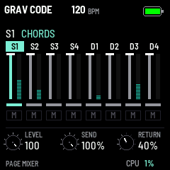

# GRAV CODE 0.26.0 — the mixer

Package: `grav_code-0.26.0.fwsc`, identity `FM-1_73002600`. After 0.25.1 (`0484140`: the colours).

SEL opens a mixer for the eight tracks: their levels, mutes, and how much of each goes through the effect.

- **The page:** each track a strip, S1 to S4 then D1 to D4: its name (the selected one's in the theme's colour), its
  LEVEL as a fader, a meter of its sound moving as it plays (falling back over 0.6 s), its SEND as a bar, and M lit
  red while it is muted. Only the strip under the track's line redraws while it sounds, ~30 times a second, as
  SEQ's does; still, nothing moves.
- **K1 LEVEL** is the selected track's level: its sound's OUTPUT level, the same as on its last sound page and kept
  with its preset. **K2 SEND** is its share through the effect, 0 to 100 %: the rest goes past the effect, dry.
  **K3 RETURN** is how much of the effect comes back: FX MIX's DRY/WET, the same setting.
- **White keys 1–8 mute** the tracks (again: on); a muted track's steps start no notes and its notes sounding end.
  The keys are lit while their track plays, dim while it is muted. **Black keys 1–8** pick a track. The other keys
  do not play on the mixer; the keys still play a muted track elsewhere, and live recording goes on.
- **SEL again** goes back to the page the mixer was opened on. On the FX pages SEL is SEED, as before (a grain by
  hand; held 2 s, the grains on their own again).
- A muted track shows MUTE at the top of every page, and its row red in step mode.
- SEND and the mutes are saved with the settings (SAVE): 16 bytes added to the record, 1420 now. Settings saved
  before 0.26 load with every track sent whole and none muted.

**How the send works.** Each voice's sound is split by its track's SEND: the sent part is mixed and goes through
Beads as the whole mix did, the rest is added after it. With every track at 100 % (as 0.26 starts, and settings from
before) the sum is made exactly as before, sample for sample; the split is computed only when some track is below.
Muting is the sequencer's (its notes are not started), so it costs no DSP.

Validation on 26 October 2026:

- All **17 simulator scenarios** pass; the new `mixer.txt` checks SEL to the mixer and back, SEL as SEED on an FX
  page, K1 LEVEL, K2 SEND, K3 RETURN, a mute stopping a track's MIDI notes and unmuting bringing them back, the black
  keys, the meters falling to rest, SAVE and a restart, and settings saved as 0.21..0.25 did (no mixer).
- **1018 bit-exact dual-core comparisons** (10 new: each track its own SEND, one core or two), and a SEND of 0 on
  every track gives exactly the sound with the effect off; the sequencer, pattern bank and preset tests pass.
- Device build/compiler checks pass: image **404804 B** (+3024), RAM **92120 / 98304 B** (**6184 B free**), pool
  **332968 / 344064 B**, package **611496 B**; no soft-double helpers, unsafe instruction patterns or direct
  register access introduced.

Package SHA-256: `d1f977f2d0c49e1946f5d3878460a97c417432bb5ad21a10a839dd1789fee513`.

Not installed on the FM-1 in this change: the meters' feel, a send's sound with REVERB, and the mutes in play need
trying there.
