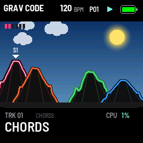

# GRAV CODE 0.29.0 — HOME under a sky; step mode's knobs on top

Package: `grav_code-0.29.0.fwsc`, identity `FM-1_73002900`. After 0.28.0 (`5c969e6`: HOME's terricons, the tracks'
colours, the engines' neon icons).

 

**A sky over HOME**, chosen on GLO's SCREEN page (GLO, GLO again), K2 SKY, beside THEME, and saved with the
settings:

- **DAY** (as it comes): a blue sky, darker up. Its sun, at the top right, flares at each kick. Three clouds drift
  across at the tempo's pace (faster at a faster tempo). The heaps stand dark against it, on dark earth.
- **NIGHT:** a dark blue sky, a crescent moon at the top left, stars twinkling; the brighter ones flash at each
  hi-hat.
- **OFF:** black, as 0.28 had it.

With a sky the page moves on its own: about 20 frames a second while all is quiet, 30 while anything sounds (10 when
the sound is busy), as before. The selected track's level moved to the top left, out of the sun's way.

**Terricons as the Donbas has them** (the fourth of four layouts tried): each heap's top is flat, a terrace runs
round each slope halfway up, and gullies run down from the top to the foot, faint, in the track's colour. Their
places and heights are new: S1 still the tallest at the left, D3 the lowest. Everything else is 0.28's: a track
without steps has none, a quiet one is dim, a sounding one bends with its sound in its engine's way (a kick's top
jumps), a muted one is grey, the selected one white at its core with its name over its top.

**Step mode: its knobs at the top.** TEMPO, SWING and LENGTH (a held step's NOTE, VELOCITY, LENGTH) are small knobs
at the page's top now, above the eight tracks' rows; the bottom band names the track and its engine (MUTE, SOLO,
FREEZE beside them) and keeps PLAY or STOP, REC, STEP, the pattern and CPU under it. The rows are a little tighter
(11 pixels apart instead of 13) so that everything fits; a knob turning redraws its own tile at the top, and the
strip of steps under the knobs redraws alone as it plays.

**GLO's SCREEN page** now has two knobs, THEME and SKY, with the ten palettes' swatches in a row under them (the
one shown framed; THEME's knob names it).

**In the code:** the settings' byte reserved since 0.12 holds the sky (`set.sky`, `SKY_DAY` = 0, so every record
saved before loads with DAY). `draw_sky` draws it under the terricons: the sky row by row, the sun's and the moon's
discs and glows pixel by pixel (the moon's dark part cut out), the clouds as four puffs each, the stars at fixed
places. `draw_track_line` is the track's line on any page and, in step mode, in its bottom band; `SEQ_STRIP_Y`
the step strip's top under the knobs (the mixer keeps `STRIP_Y`). A test hook `sky`, and a simulator command
`sky N` for the pictures.

Validation on 28 October 2026:

- All 18 simulator scenarios pass, and the screenshot script. `theme.txt` checks SKY: DAY at first, OFF, DAY,
  NIGHT, no further either way, saved through a restart; THEME's K3 still does nothing. `seq.txt` checks that with
  a sky HOME goes on moving once stopped, and with SKY OFF stands still, as before.
- The pictures are new: HOME by day and at night (`screen-night.png`), step mode, SCREEN, the lists over HOME, GLO's
  version and the playing GIF.
- The sequencer, pattern bank, preset and 1018 bit-exact dual-core tests pass.
- Device build/compiler checks pass: image **419796 B** (+2240), RAM **92568 / 98304 B** (**5736 B free**), pool
  **332968 / 344064 B**. Package **611496 B**; no soft-double helpers, unsafe instruction patterns or direct register
  access introduced.

Package SHA-256: `1fc940f1fbde7780c2c8025c39b0e4f1af2264402a21f0e85525903564a434ea`.

Not yet installed on the FM-1. How smooth the sky is there (a whole page drawn 20 to 30 times a second, its sun and
moon pixel by pixel) needs a look on the device.
