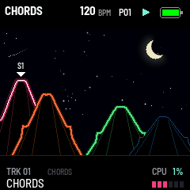

# GRAV CODE 0.29.1 — the night alive

Package: `grav_code-0.29.1.fwsc`, identity `FM-1_73002901`. After 0.29.0 (`cf5121f`: HOME under a sky).

Asked for after 0.29.0 ran on the FM-1:

- **The moon at the right** (where the sun is by day), and alive: its light shimmers, its glow breathes in and out,
  and a ripple of light goes out from it now and again. Its crescent is softer towards its dark part.
- **The stars come and go.** Each one comes out, shines a few seconds (5 to 10), fades and comes out again
  somewhere else, each at its own pace, so the sky is never the same twice; they twinkle as they shine, and the
  brighter ones (a small cross of light) flash at each hi-hat. Some are white, some bluish, some warm. Now and then
  (every 11 seconds) a shooting star crosses down to the left.
- **The heaps dark by day.** Under the blue sky the terricons are dark, as spoil heaps are: their tracks' colours
  only on their rims, low, a little brighter as they sound; their gullies grey. At night and with the sky OFF they
  keep 0.28's colours.
- **The level at the bottom right.** The selected track's level, six segments in its colour, is in HOME's bottom
  band now, at its right, where it was empty; the sky's corners are the sun's and the moon's. It still follows the
  sound every frame (a small piece of the band redrawn with the page).

Validation on 29 October 2026:

- All 18 simulator scenarios pass, and the screenshot script.
- The pictures are new: HOME by day and at night, the lists over it, GLO's version, the playing GIF, and an
  animated night (`home-night.gif`) in the manual.
- The sequencer, pattern bank, preset and 1018 bit-exact dual-core tests pass.
- Device build/compiler checks pass: image **421828 B** (+2032), RAM **92568 / 98304 B** (**5736 B free**), pool
  **332968 / 344064 B**. Package **611496 B**; no soft-double helpers, unsafe instruction patterns or direct register
  access introduced.

Package SHA-256: `536cb629a3a4c775ccb329e97d93beae3d5484bd830457dcaf3fdc28f2eda57d`.

Not yet installed on the FM-1.
