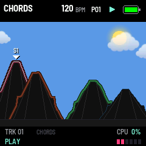

# GRAV CODE 0.30.0 — the engine in the header; soft clouds in a lighter sky

Package: `grav_code-0.30.0.fwsc`, identity `FM-1_73003000`. After 0.29.3 (`2e3856c`: lower clouds, a clean moon,
every icon in its box).

- **The header names the selected track's engine** where it said GRAV CODE: CHORDS, KICK, WAVESHAPE ... on every
  page, changing as SELECT picks another track or ALGO another engine. A name too long for the header's left part
  is drawn smaller. (GRAV CODE stays on the splash at power-on.)
- **The day sky is a lighter, clear blue** (the second of three tried), still one colour.
- **The clouds are soft and see-through.** Each is eleven puffs of different sizes, a little apart differently from
  cloud to cloud, so each has its own shape. Each is densest in its middle and thins to its edge, where the sky
  shows through; at most three quarters white. They are bright on top and a little greyer and bluer below, as a
  cloud lit from above is. They still drift low over the heaps at the tempo's pace.

Tried on the way and dropped: Mario's look (a light sky, green heaps, pixel clouds with a dark outline).

Validation on 29 October 2026:

- All 18 simulator scenarios pass, and the screenshot script.
- Every picture is new (the header is on all of them), the engines' poster, and four GIFs: the playing bar, the
  knobs easing, HOME at night, and HOME by day (new, in the manual).
- The sequencer, pattern bank, preset and 1018 bit-exact dual-core tests pass.
- Device build/compiler checks pass: image **423044 B** (+432), RAM **92568 / 98304 B** (**5736 B free**), pool
  **332968 / 344064 B**. Package **611496 B**; no soft-double helpers, unsafe instruction patterns or direct register
  access introduced.

Package SHA-256: `7a6c036a6a57491a8d49a7775c9f8b0c5a5731dd0447e3bcf46e650fe1675403`.

Not yet installed on the FM-1.
