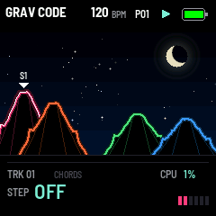
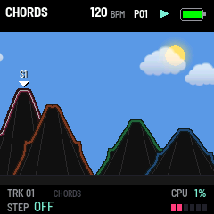

# GRAV CODE 0.30.2 — night as it comes; the day's light blue sky again

Package: `grav_code-0.30.2.fwsc`, identity `FM-1_73003002`. After 0.30.1 (`274ac73`: a bigger step grid).

 

**Night as it comes.** HOME's sky (GLO's SCREEN, K2 SKY) starts at NIGHT now: the moon, the stars, the shooting
star. The pictures in the docs are at night too; the day has its own picture (`screen-day.png`) and its GIF.

**The day's sky again.** By DAY HOME has a sky again, a light blue one, lighter than 0.30.0's (the third of the
variants shown), with the sun flaring at each kick. The three clouds are see-through again, bright on top and greyer
below, and drift as slowly as 0.30.1's, still at the tempo's pace, blended over the sky and the sun under them.

**Saved settings.** The sky is stored as 1 NIGHT, 2 OFF, 3 DAY. A 0 there (settings saved before 0.29, and DAY as
0.29 to 0.30.1 saved it, their default) loads as NIGHT; an FM-1 that had NIGHT or OFF keeps it. To get the day
back, pick DAY on SCREEN's K2 and SAVE.

Validation on 29 October 2026:

- All 18 simulator scenarios pass, and the screenshot script; the SKY tests now start at NIGHT and check the day
  survives a restart.
- The pictures are new, at night: HOME, step mode, the lists, SCREEN, the playing GIF; the day's picture and GIF.
- The sequencer, pattern bank, preset and 1018 bit-exact dual-core tests pass.
- Device build/compiler checks pass: image **423060 B** (+80), RAM **92568 / 98304 B** (**5736 B free**), pool
  **332968 / 344064 B**. Package **611496 B**; no soft-double helpers, unsafe instruction patterns or direct register
  access introduced.

Package SHA-256: `f0338eedc3c234407088597428413da4bf55ee4bafba0ccbcf6d2a75e96fa682`.

Not yet installed on the FM-1.
