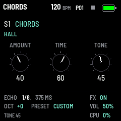
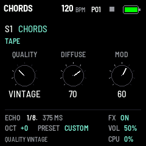
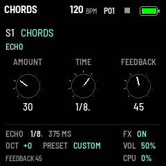

# GRAV CODE 0.32.0 — HALL, TAPE, ECHO: Beads' reverb alone, and an echo in time

Package: `grav_code-0.32.0.fwsc`, identity `FM-1_73003200`. After 0.31.0 (`1f296f4`: the track alone).

  

**The effect, new.** Until 0.31 it was all of Mutable Instruments Beads: its grains, their delay, its tape, its
reverb, FREEZE and SEED, with one REVERB knob for the reverb's level and length together. Now it keeps Beads' reverb,
its tape's wow and flutter and its 8-bit colour, adds an echo in time with the tempo, and gives each its own knobs.
FX turns its three pages:

| Page | K1 | K2 | K3 |
| --- | --- | --- | --- |
| HALL | AMOUNT (into the reverb) | TIME (the tail) | TONE (dark to bright) |
| TAPE | QUALITY (DIGITAL, VINTAGE, CLEAN TAPE, DIRTY TAPE) | DIFFUSE (the reflections' blur) | MOD (the tail's movement) |
| ECHO | AMOUNT (into the echo) | TIME (1/32 to 1/2, triplets and dotted, at the tempo) | FEEDBACK |

- **Both AMOUNTs are sends.** Turned down, nothing more goes in and what is in rings out; once it has died away the
  effect is off and costs nothing. The mixer's RETURN is HALL's AMOUNT.
- **QUALITY colours the effect alone,** the dry sound clean: VINTAGE 12 bits; CLEAN TAPE saturated with a little wow
  and flutter; DIRTY TAPE 8-bit μ-law, saturated, the full wow and flutter. Off DIGITAL the reverb is longer and
  darker, and the echoes darken as they go round.
- **ECHO follows the tempo** (a MIDI clock in too). Its line holds 1.1 s: a longer time, at a slow tempo, is halved
  until it fits. A change of TIME glides, as a tape does. The bottom band shows it: ECHO 1/8. 375 MS.
- **Gone:** the grains (DENSITY, SIZE, SHAPE, PITCH), DRY/WET, FREEZE (EDIT is free now) and SEED (SEL on an FX
  page opens the mixer, held or not).

The reverb is Beads' own topology (`dsp/grav_reverb.h`), wet only, its diffusion and its modulation's depth set
from outside; at DIFFUSE 72 and MOD 63 it is, near enough, Beads' as it was. Of `vendor/beads`, only the reverb engine, the wow and
flutter and the μ-law are left.

**Saved settings.** Settings saved by 0.31 or before load with their REVERB as HALL's AMOUNT (the same curve), the
effect's other knobs at rest and their QUALITY kept; DRY/WET is dropped.

**Room.** The RAM in use falls from 92568 to 68280 bytes: **30024 B free** (5736 before), as Beads' processor (25 KB)
goes. The image is 50672 B smaller. The pool stays as it was: the echo's line takes the 96 KiB the grains had.

Validation on 29 October 2026:

- All 19 simulator scenarios pass, and the screenshot script. `fx.txt` is new: the three pages, the effect going
  off by itself once its tails die, every ECHO time, the QUALITY steps, a record as 0.31 saved it, one as 0.12 did.
- The 1018 bit-exact dual-core comparisons pass with the new effect on, every QUALITY in turn, its sends switched
  off and on mid-way; the sequencer, pattern bank and preset tests pass.
- Device build/compiler checks pass: image **374852 B** (−50672), RAM **68280 / 98304 B** (**30024 B free**), pool
  **332968 / 344064 B**. Package **611496 B**; no soft-double helpers, unsafe instruction patterns or direct register
  access introduced. On the host, the reverb alone takes about a quarter of the time all of Beads took; the FM-1's
  DEBUG page will tell its own figure.

Package SHA-256: `3fb59eac50a9682f1ab6222bc8a3be0cbb88f824e187968b2b0742f964e2787c`.

Not yet installed on the FM-1.
