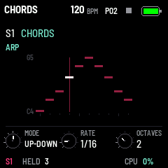

# GRAV CODE 0.34.0 — the arpeggiator (ARP)

Package: `grav_code-0.34.0.fwsc`, identity `FM-1_73003400`. After 0.33.0 (`5cd25dc`: the lake).

 

**ARP, at last.** The button the FM-1's panel had kept for it now opens the selected synth track's arpeggiator. ARP
shows its page, ARP again its second; the button is lit while the track's arp is on.

| Page | K1 | K2 | K3 |
| --- | --- | --- | --- |
| ARP | MODE: OFF, UP, DOWN, UP-DOWN, RANDOM, AS PLAYED, CHORD | RATE: 1/32 to 1/2, triplets and dotted, at the tempo | OCTAVES: 1 to 4 |
| ARP 2 | GATE: 5 to 100 % of RATE | HOLD: the notes kept once the keys are let go | — |

- **What it plays:** the keys and MIDI in on the selected track, and the track's own steps: a chord step is held for
  its length and played through the arp. Recording records the keys, not the arp's notes.
- **In time:** while the song plays, its notes fall on the song's grid, 24 ticks a quarter note as MIDI clock goes (a
  clock in's too); stopped, the first note sounds at once and the rest follow at the tempo.
- **Out over MIDI:** its notes go out on the track's channel, as the sequencer's do; the keys' own do not while it is on.
- **Part of the sound:** SAVE keeps it, a user preset holds it, ALGO keeps it when the engine changes; factory presets
  and every sound from before have it OFF. The three bytes it takes were reserved in the sound; nothing else in the
  settings or the patterns changed. A drum track has none.
- **On the screen:** a ladder, its notes across in the order it plays them, each as high as its pitch, in the track's
  colour, the note playing white; the knobs small in the bottom band, with the notes held and HOLD.

It lives in the sequencer (`seq/seq.c`, `seq_arp_*`): its notes are the sequencer's events, so they reach the voices
on the 24-sample grid and go out over MIDI as the steps' do.

Next: parameter locks on EDIT (LOCK mode), with knob-motion recording and locks without a note. The plan is in
`SEQUENCER_PLAN.md`.

Validation on 29 October 2026:

- All 20 simulator scenarios pass, and the screenshot script (`screen-arp.png` new). `arp.txt` is new: the pages, each
  knob said, the keys through the arp and none of theirs out over MIDI, HOLD, a drum track, SAVE and a reboot, MIDI
  in, a chord step played through it.
- The sequencer test checks the arp to the sample: UP over two octaves on a chord step, DOWN and UP-DOWN at a 32nd,
  GATE, its own ticks when stopped, HOLD, CHORD, turning it off, and a MIDI clock in.
- The 1018 bit-exact dual-core comparisons, the pattern bank and the preset tests pass.
- Device build/compiler checks pass: image **388728 B** (+6724), RAM **70848 / 98304 B** (**27456 B free**), pool
  **332968 / 344064 B**. Package **611496 B**; no 64-bit multiply beside a load, no soft-double helpers, no direct
  register access.

Package SHA-256: `55962aaa33308fc80f28f142dd2aeef42fe963c7cf190a7619482d3758b9cb41`.

Not yet installed on the FM-1.
