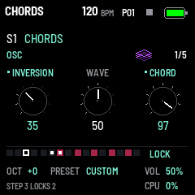

# GRAV CODE 0.35.0 — parameter locks (EDIT: LOCK mode)

Package: `grav_code-0.35.0.fwsc`, identity `FM-1_73003500`. After 0.34.0 (`09ca556`: the arpeggiator).

**A step's own knobs.** A step can now lock a track's knob to its own value: from that step until the track's next
step that plays or locks. A step that plays without locks brings the track's own knobs back, and so does stopping.

- **LOCK mode on EDIT** (tap, lit while on): on every page the white keys are the selected track's steps (OCT- and
  OCT+ the other pages of 16), the black keys the tracks. The keys light the steps locked or held, half the ones with
  a note; the bottom band shows the 16 steps, the locked marked, and LOCK.
- **Hold a step and turn a knob:** the step locks it (several held: each). While held, its locks are heard and the
  page shows them, a locked knob in the theme's colour, marked.
- **What locks:** OSC's three knobs; a drum track's DRUM page (TUNE and its two) and SHAPE; the mixer's VOL and SEND.
  Elsewhere: LOCK NOT ON THIS PAGE.
- **A lock without a note:** a step that is off can lock: it changes the sound as the song passes, no note.
- **The knobs' moves recorded:** recording live in LOCK mode, a knob turned locks the step playing, heard at once.
- **Clearing:** EDIT held and a white key clears that step's locks; a step taken off in step mode, or a track cleared
  (SEQ held, REC), loses its locks too.
- **On the grid:** a step with locks has a white mark at its foot.

**Saved with the pattern.** A pattern holds up to 512 locks (4 bytes each): it grows from 4140 to 6192 bytes, in its
8 KiB slot of the flash. Patterns saved before load as they were, without locks: the bank takes their size too.

How it works: the sequencer sends a lock event at each step that plays or locks, before its notes; the render builds
each track's sound from its knobs with the step's locks over them (and a held step's over those).

Validation on 29 October 2026:

- All 21 simulator scenarios pass, and the screenshot script (`screen-lock.png` new). `locks.txt` is new: LOCK mode,
  a lock on a held step heard while held, a lock without a note, clearing with EDIT, a page without locks, playing
  (a lock until the track's next step), recording the knobs, the mixer's SEND, a drum's TUNE, the steps' pages, SAVE
  and a reboot.
- The sequencer test checks the locks' pool (set, sorted, cleared, full) and their events (at each step, before its
  notes, a step off with locks alone); the bank test saves a pattern with locks and reads it back, and takes one as
  0.34 saved it, without locks.
- The 1018 bit-exact dual-core comparisons and the preset tests pass.
- Device build/compiler checks pass: image **392824 B** (+4096), RAM **73120 / 98304 B** (**25184 B free**), pool
  **332968 / 344064 B**. Package **611496 B**; no 64-bit multiply beside a load, no soft-double helpers, no direct
  register access.

Package SHA-256: `1aff4264d3240dc30f6eeb534bb8c4f37660df1fae5fd4512e076cff6d70edda`.

Not yet installed on the FM-1.
