# Terykons

Terykons turns the M-VAVE FM-1 into a polyphonic synthesizer on all 24 sound engines of Mutable Instruments'
Plaits, through an echo in time with the tempo and the reverb of Mutable Instruments' Beads: up to four voices, each its
own engine, played from the keys with velocity or over MIDI, shaped by an envelope and moved by an LFO, and a
sequencer of eight tracks of 64 steps, four synth tracks (each its own engine) and four drum tracks (Plaits' bass
drums, snares and hi-hats, each with six knobs), in sixteen patterns, with swing and MIDI clock. Everything is on the FM-1's own panel and screen; the settings
and the pattern stay across a power cycle. Until 0.36 it was called GRAV CODE.

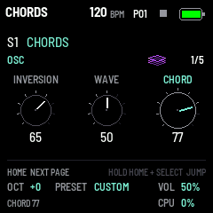

---

## Contents

1. Install
2. The screen
3. Controls
4. The pages
5. The sequencer
6. The engines
7. The effect (FX)
8. Voices and velocity
9. Saving
10. MIDI and USB audio
11. CPU and its limits
12. Troubleshooting
13. Credits and licences

---

## 1. Install

**Try it first:** the emulator on the site runs the same code in the browser, with sound, played with the mouse, a
touch screen or the computer keyboard.

**Install from the browser:** in Chrome or Edge, connect the FM-1 by USB (a data cable), open the installer and
press Install. The browser asks once to allow MIDI: allow it. Don't unplug the cable while it writes; the FM-1
restarts into Terykons when it is done. Coming from another firmware, leave it running as it is: no update mode is
needed.

**Install from a terminal:** `python3 tools/fm1_install.py terykons-VERSION.fwsc` (it needs Python's `mido` and
`python-rtmidi`).

**Back to the stock firmware:** the installer's last section writes M-VAVE's own firmware back. Installing is at
your own risk.

---

## 2. The screen

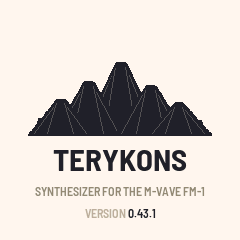

At power-on, the logo (0.36): five terricons in ink (0.43.1: no sun behind them), the name and the version under them (0.36.1), for
about two seconds while the FM-1 starts (a key, a button or a knob turned ends it at once; the FM-1 plays meanwhile).

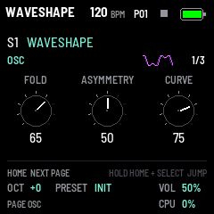

From the top:

- **The header:** the selected track's engine (since 0.30; Terykons before), as SELECT and ALGO change it;
  in the middle the tempo, the whole song's, in BPM (in the theme's teal while a MIDI clock coming in
  leads, section 5); the pattern playing (P01) and a triangle while it plays, a square stopped, a red dot recording
  (0.27); the battery: three bars, green when full, yellow, then red; a lightning bolt while the FM-1
  runs on USB power. The page you are on is the one whose button blinks (faster on its second and third pages).
  Terykons starts on SEQ, the sequencer's page (section 5).
- **The track selected** (S1 to S4, D1 to D4) and its engine, by its name. Turning SELECT shows the eight tracks for a
  moment, the selected one lit, each with its engine, its icon (small) and its voices.
- **The page's three parameters** as knobs, K1 to K3, on every page: a thin ring, ticks over its travel lit up to
  the value, a pointer easing to it; the name above, the value under. A knob that starts from the middle (DENSITY,
  PITCH, TUNE) has a longer tick there. The knob being turned grows a little and takes the theme's colour, then
  settles back. In step mode (SEQ) its knobs are small, at the page's top, above the tracks' steps (section 5); on
  the mixer's and PAN's (0.43), the effect's (0.33) and the arp's (0.34) pages small too, in the bottom band.
- **The bottom band:** the page's state (a sound page: how to change pages);
  OCT (the octave), PRESET (the selected sound, or CUSTOM after editing), VOL (MASTER); a message, or the last MIDI
  message in and where from (USB or TRS); CPU, the share of its time the sound takes: it turns red once a block of
  sound came late (heard as a crackle), until the next power-on. In step mode (0.30.1) one line: PLAY or
  STOP, REC or STEP (the track alone: its name and NOTES, a drum's STEPS), the pattern, UNSAVED, and CPU
  (the engine is in the header). In LOCK mode (0.35) the page's state is the 16 steps on the white keys and LOCK. On
  the mixer, PAN (0.43), the effect's (0.33) and the arp's (0.34) pages the page's knobs,
  small, and under them what the mixer's keys do, ECHO's time and whether the effect is on, or the notes the arp
  holds; and CPU. The keys are not drawn: the
  FM-1's own are under the screen.

---

## 3. Controls

| Control | What it does |
| --- | --- |
| Keys | Play, with velocity (or a fixed one: GLO). 27 keys, F3 to G5 at OCT +0. On the TEMPO page (0.38): tap the tempo |
| OCT- / OCT+ | The octave, -2 to +2. Keys held keep their notes until they are let go. In step mode: the pages |
| ALGO (knob) | The selected track's engine: all 24 in Plaits' order, round from the last to the first; a drum track's: its drum, one of six (section 6). Each turn shows the engine's splash for a moment |
| PRESET (knob) | The presets' browser (0.27, section 9): every sound the track can play, engine after engine; each chosen plays at once, the engine changing with it. OCT+ its engine's alone, OCT- back as it was; it closes 3 s after the last turn. A sound changed after its preset reads its name with a * |
| SELECT (knob) | The track: S1 to S4, then D1 to D4, on every page (the keys, MIDI in, PRESET, OSC, VOICES and the steps are for it); while step recording, the step |
| K1, K2, K3 | The page's three parameters (the GLO page: its settings) |
| K4 | The pattern: the next one (section 5) |
| HOME | HOME's terricons (every track, 0.28) → TEMPO (0.36.2: TEMPO, SWING, LENGTH) → OSC → extra sound pages → OUTPUT → the terricons. A drum track: DRUM → SHAPE → OUTPUT. From step mode: the terricons. Hold HOME and turn SELECT to jump sound pages; with a white key, choose a pattern (several one after another: a chain, 0.41); with OCT-, OCT+, REC: copy, paste, clear it (0.40, section 5) |
| LFO | The MOD page: the selected synth track's LFO RATE, LFO DEPTH, LFO DEST |
| ENV | The ENV page: the selected synth track's ATTACK, DECAY, RELEASE |
| GLO | The GLO page: VOICES, VELOCITY, METRONOME; again MIDI (0.39: the tracks' channels, IN, CLOCK); again USB (0.42: USB AUDIO, STEREO or MULTI, each track on its own channel); again SCREEN (THEME, the screen's colours); again DEBUG (section 11) |
| FX | The effect's pages, again for the next (0.32): HALL, TAPE, ECHO (section 7). Lit while the effect runs |
| ARP | The selected synth track's arpeggiator (0.34): ARP (MODE, RATE, OCTAVES), again ARP 2 (GATE, HOLD) (section 4). Lit while it is on |
| EDIT | LOCK mode (0.35): tap, on or off; held with a white key, that step's locks cleared (section 5). Lit while on (0.32..0.34 free; FREEZE before) |
| SEL | The MIXER (section 4), from every page; SEL again: PAN (0.43, each track's place from left to right); again: back to the page it was opened on |
| SEQ | Step mode: every track on the screen, the white keys their steps (section 5). Lit while on. SEQ again (0.31): the selected track alone, a synth track's notes as a piano roll, a drum track's 64 steps; a third time: back to the page it was pressed on |
| PLAY | The sequencer: start, stop. Green on each beat while it plays; red while recording |
| REC | Stopped: step recording; playing: live recording (section 5). Held SEQ, then REC: the selected track cleared |
| MASTER | The volume, glided: no step in the sound |
| SAVE | Tap: stores settings and pattern, the white keys lighting one after another, first to last (0.31). Hold: user preset slots; OCT-/+ changes page, a white key saves/replaces the slot. Lit while changes remain unsaved (section 9) |

The page shown has its button blinking: slowly on a button's first page, faster on the next (FX: HALL, TAPE,
ECHO; ARP: ARP, ARP 2; HOME: SEQ, TEMPO, OSC; GLO: GLO, MIDI, USB, SCREEN, DEBUG; SEL: MIXER, PAN).

**At power-on:** OCT- and OCT+ held is the panel's setup (the knobs' and keys' calibration); REC held starts the
chip's update mode, a way to install when Terykons starts but its USB can't be reached.

---

## 4. The pages

### SEQ (HOME)

The sequencer's page, Terykons' main one: section 5.

### TEMPO (HOME again, 0.36.2; tap tempo, 0.38)

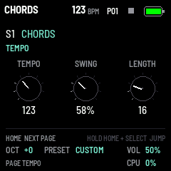

From HOME's terricons, HOME again shows the song's time as knobs: **TEMPO** (K1, 30 to 300 BPM, the whole song's),
**SWING** (K2, the selected track's, grey while it is the pattern's) and **LENGTH** (K3, the selected track's steps,
1 to 64). They are the knobs HOME's terricons and step mode have too (section 5), shown here. HOME again: OSC.

**Tap tempo (0.38).** On this page every key taps the tempo instead of playing (no note, no MIDI out): tap along with
the beat, and from the second tap TEMPO is the taps' average over the last four beats (TAP TEMPO and the BPM; the
first says TAP AGAIN). A pause longer than 2.5 s starts a new count; it stays within 30 to 300 BPM. While the song
plays it follows at once. SAVE keeps it, as TEMPO turned. A key held from another page still lets its note go; HOME
held with a white key still picks a pattern, and in LOCK mode the white keys are still the steps. Following a MIDI
clock in, the clock leads: a tap says TEMPO MIDI CLOCK and changes nothing.

### OSC (HOME a third time)

The first sound page retains the engine's three main parameters, as on Plaits: **TIMBRE** (K1), **MORPH** (K2) and **HARMONICS** (K3). What each
does depends on the engine: section 6. They start at 65, 50 and 75.

K1 to K3 are drawn as small knobs, in the Octatrack's manner: a thin ring, nine ticks over its travel (lighter up to the
value; a centred control's middle tick longer), a pointer that eases to the value; the name above, the value under,
and a mode under that when it matters (AUX, WORDS, DX). They are grey and white; the knob being turned lights in the
theme's colour for a moment. The page title and number and a compact live engine icon sit above them. Each engine's icon is drawn by Terykons as a neon picture
in the engine's own colour (since 0.28; the engines' poster in section 6), and moves with its knobs and its notes:
WAVESHAPE's ribbons fold further as TIMBRE goes up, FM 2-OP's loops bend with INDEX and multiply with RATIO, CHORDS
stacks a plane for each note of its chord, a kick's rings jump out at each hit, a snare bursts into rays. Lines that
cross grow brighter, as neon does. Each keeps inside its box with a margin (0.29.3), never cut by its edge. A drum's DRUM and SHAPE pages show it the same way.

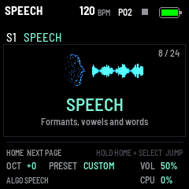

**The splash:** turning ALGO shows the new engine for a moment over the page: its icon, its name and its line.

### Advanced sound pages (0.22)

HOME advances through independent engine controls, then OUTPUT; hold HOME and turn SELECT for fast navigation.
AUTO follows the original macro; turn left past zero to restore it. OUTPUT adds TUNE, LEVEL and AUX MIX. Dedicated
drums instead get LEVEL, ACCENT and HOLD, alongside their existing DRUM/SHAPE pages.

The three six-op banks have 57 sound pages each: 151 additional patch fields, including all operator levels,
frequency/mode/detune, four envelope rates and levels, scaling, velocity and modulation, algorithm/feedback,
internal LFO and pitch envelope. Changes reach held notes. Changing PATCH on OSC resets the operator edits to
that patch. Native DX envelope values are 0–99, rather than milliseconds. [Full control reference](SOUND_CONTROLS.md).

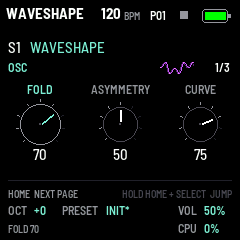
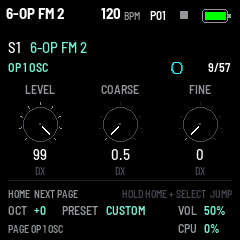

### DRUM, SHAPE (HOME again, on a drum track)

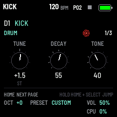

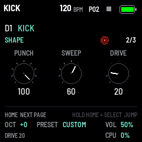

On a drum track HOME opens two pages of the drum's own knobs instead of OSC, then SEQ again (HOME blinks faster on
the second):

- **DRUM:** **TUNE** (K1, from the middle: a half semitone a detent, up to two octaves either way, on every note the
  track plays), **DECAY** (K2), **TONE** (K3).
- **SHAPE:** a kick's **PUNCH** (the pitch's jump at the attack), **SWEEP** (the body's pitch bending with its own
  level; on SYN KICK the sweep's time) and **DRIVE** (overdrive; on SYN KICK its dirt); a snare's **SNAPPY** (the
  snares' noise against the drum), **DRIVE** and **LEVEL**; a hi-hat's **NOISE** (noise against the metal), **DRIVE**
  and **LEVEL**.

### MOD (LFO)

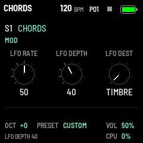

Each synth track's own LFO (0.37; before, one for all the voices): a sine, free-running (a note doesn't restart it).
The page shows the selected track's:

| Knob | Parameter | Range |
| --- | --- | --- |
| K1 | LFO RATE | 0.05 Hz to 20 Hz (50: 10 Hz) |
| K2 | LFO DEPTH | 0 (off) to 100 |
| K3 | LFO DEST | TIMBRE, MORPH or PITCH; one step selects the next destination |

At full depth it sweeps TIMBRE or MORPH by half their range either side of the knob, or the pitch by 2 semitones
either side. It starts at RATE 50, DEPTH 0 (off).

**Part of the track's sound.** SAVE keeps each track's, a user preset holds it, and a factory preset brings it as it
starts (RATE 50, DEPTH 0); a preset saved before 0.37 leaves the track's as it was, and settings from before 0.37 give
each synth track the one LFO they had. LFO RATE and LFO DEPTH can be locked on a step (section 5), DEST not. A drum
track has none: its MOD page reads THE LFO IS S1-S4'S, and a knob turned there LFO/ENV S1-S4 ONLY.

DEST selects what the LFO changes; DEPTH sets how much it changes. Old saved numeric destinations keep
their meaning (0–33 TIMBRE, 34–67 MORPH, 68–100 PITCH). On 6-OP FM, MORPH changes the DX patch's
envelope timing, which may be subtle or inaudible once a patch has settled or decayed. TIMBRE and PITCH
are the useful destinations for continuous brightness or pitch modulation.

### ENV (ENV)

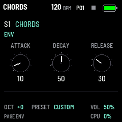

Each synth track's envelope (0.37; before, one for all), which shapes the level of its voices. The page shows the
selected track's:

| Knob | Parameter | Range |
| --- | --- | --- |
| K1 | ATTACK | 0 to 2 s |
| K2 | DECAY | 0 to 2 s, down to a sustain of 70 % |
| K3 | RELEASE | 0 to 4 s, after the key is let go |

It starts at ATTACK 10 (0.2 s), DECAY 50 (1 s) and RELEASE 30 (1.2 s).

Like the LFO it is part of the track's sound (SAVE, a user preset; a factory preset brings these three), and all three
can be locked on a step: a step's lock reaches the notes playing too, a long ATTACK on one step, a short RELEASE on
another. A drum track has none: its drums decay by their own DECAY; its ENV page reads A DRUM ENVELOPES ITSELF.

A repeated note restarts the attack from zero even if the previous release is still running. A short
2 ms fade removes the old level before a nonzero attack. Changing RELEASE during a release updates
its remaining fade rate without a level jump.

> The engines with an envelope of their own play through it, as Plaits' low-pass gate lets them: BASS DRUM, SNARE,
> HI-HAT and SPEECH while it speaks a word. The three 6-OP FM banks keep their DX operator envelopes,
> with the app's ENV applied to their final volume. ENV cannot extend a patch that has already decayed
> to silence. Sustain is fixed at 70%; this page exposes attack, decay and release.

On 6-OP FM the DX gate stays high while the app's release fades the output. The voice is reset at zero
amplitude before sleeping, so its old gate/release cannot reappear on the next note. A patch's natural
decay while held still exists; extending RELEASE cannot restore a carrier that has already gone silent.

### MIXER (SEL)

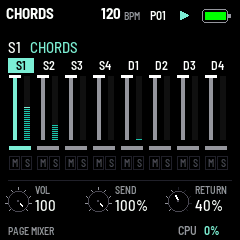

SEL opens the mixer, from every page; SEL again opens PAN (0.43, below), and again goes back to the page the mixer
was opened on. Each track is a strip, S1 to S4 then D1 to D4:

- **its name**, the selected track's in the theme's colour;
- **its VOL** as a fader: the mixer's own (0.27), which a preset never changes (its sound's OUTPUT LEVEL is
  another, kept with the preset);
- **a meter** of its sound beside it, moving as it plays and falling back over 0.6 s;
- **its SEND** as a bar under them: how much of it goes through the effect; the rest goes past it, dry;
- **M**, lit red while it is muted; **S**, lit in the theme's colour while it is soloed. A track silent (muted, or
  another soloed) has its strip dim.

| Control | What it does |
| --- | --- |
| K1 VOL | the selected track's fader, 0 to 100 (100: as before 0.27) |
| K2 SEND | its share through the effect, 0 to 100 % (100 %: all of it, as before 0.26; 0: none, it stays dry) |
| K3 RETURN | how much goes into the reverb: HALL's AMOUNT, the same knob (0.32; FX MIX's DRY/WET before) |
| White keys 1–8 | mute a track (S1 to D4): its steps start no notes and its notes sounding end; again: on. The keys are lit while their track plays, dim while it is muted |
| Black keys 1–8 | solo a track (again: not); several at once. While any track is soloed, only the soloed ones sound, whatever their mutes; the mutes come back as they were once no track is. The keys are lit while their track is soloed. Solos are not saved |
| SELECT | pick the track K1 and K2 are for |

The other keys do not play on the mixer. A silent track (muted, or another soloed) shows MUTE at the top of every
page and its row red in step mode; a soloed one shows SOLO. The keys still play a silent track. Live recording goes on while muted. SEND and the mutes are saved with the settings
(SAVE); settings saved before 0.26 have every track sent whole and none muted.

### PAN (SEL again, 0.43)

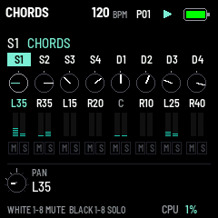

SEL on the mixer opens PAN: where each track sits between the left and the right. SEL again goes back to the page
the mixer was opened on. Each track is a strip, as on the mixer:

- **its name**, the selected track's in the theme's colour;
- **a pan pot**: its pointer up in the centre, at its left end full left, at its right end full right;
- **its PAN** in words: L50 (full left) to L1, C (the centre), R1 to R50 (full right);
- **two meters**, its sound on the left and on the right: both full in the centre, the far one emptier as it moves
  to a side, empty at the end;
- **M** and **S**, as on the mixer.

| Control | What it does |
| --- | --- |
| K1 PAN | the selected track's place, L50 to C to R50 (C: as before 0.43) |
| White keys 1–8, black keys 1–8 | mute and solo, as on the mixer |
| SELECT | pick the track K1 is for |

PAN places a track's own sound; what it sends through the effect (SEND) goes in as before, in the middle, and the
reverb's and the echo's tails spread over both sides as they always have. The pan is constant power: a track at a
side is 3 dB louder on that side than on either in the centre, and silent on the other, so it sounds as loud moved
as it did in the middle. Every track in the centre, the sound is as before 0.43, sample for sample. PAN is not
locked on a step (LOCK NOT ON THIS PAGE). Saved with the settings (SAVE); settings from before 0.43 have every track
in the centre. In USB audio MULTI (section 10) the mix on 1-2 has the pans; each track's own input stays mono.

### GLO (GLO)

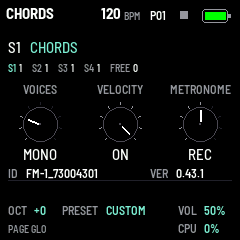

The firmware and its global settings:

| Knob | Setting | Values |
| --- | --- | --- |
| K1 | VOICES | The selected synth track's: OFF, MONO (each track's at first), 2, 3, 4; four in all, never another's last (section 8). A drum track's: DRUM, its own |
| K2 | VELOCITY | ON (right: the keys play as they land), OFF (left: at a fixed 100) |
| K3 | METRONOME | OFF (left); REC (middle: a click on each quarter note while recording live, the bar's first higher and louder); COUNT (right: REC, and a bar's count-in when recording starts from a stop) |

Above the knobs, how the four voices are shared out: S1..S4 each its number (OFF in red, the selected track's
lit) and FREE, those no track has. Under them, the package's identity (the installer's) and the firmware's version.
Section 8 has more on VOICES and VELOCITY, section 5 on the metronome.

### MIDI (GLO again, 0.39)

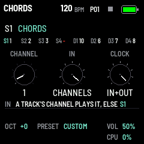

GLO again opens MIDI, how Terykons talks to other gear (section 10):

| Knob | Setting | Values |
| --- | --- | --- |
| K1 | CHANNEL | The selected track's MIDI channel (SELECT picks the track): OFF (left), 1 to 16. At first S1 to S4 on 1 to 4, D1 to D4 on 5 to 8, as before 0.39. OFF: the track sends no MIDI (it still plays), and IN CHANNELS gives it none |
| K2 | IN | SELECTED (left, as it comes): a note in on any channel plays the selected track. CHANNELS (right): a note in on a track's channel plays that track (on several, all of them); on a channel no track has, the selected one |
| K3 | CLOCK | OFF, IN, OUT, IN+OUT (right, as it comes): whether the clock (with Start, Continue and Stop) is followed from MIDI in, sent out while the song plays by its own tempo, both, or neither |

Above the knobs every track with its channel (the selected one lit, OFF a red dash); under them what IN does just
now. A note out keeps its channel: the note-off goes where its note-on went, the channel changed meanwhile or not; a
note in held goes to the tracks it started on, IN or the selected track changed meanwhile or not. CLOCK OUT turned
off while the song plays by its own tempo sends a Stop; CLOCK IN turned off while it follows a clock stops it. All
three are saved with the settings (SAVE); settings from before 0.39 keep MIDI as it was.

### USB (GLO again, 0.42)

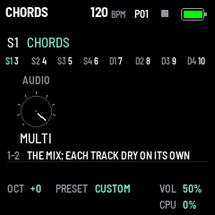

GLO again opens USB, what the computer gets over the cable (section 10):

| Knob | Setting | Values |
| --- | --- | --- |
| K1 | AUDIO | STEREO (left, as it comes, as before 0.42): the mix to the computer on its inputs 1-2, and the computer's sound through the FM-1. MULTI (right): the mix on 1-2 and each track on an input of its own, S1 to S4 on 3 to 6, D1 to D4 on 7 to 10, at a fixed level, on the computer's clock (for a DAW: section 10); the computer's sound through the FM-1 as in STEREO (0.42.1; 0.42.0: none) |

A turn reconnects the FM-1 to the computer (about a second): the computer finds it again with its new inputs (an
app recording from it may need its audio device chosen again). In MULTI a Mac sees one device, Terykons FM-1 with
10 inputs and 2 outputs (0.42.2; before, the input and the output were two). Above the knob every track with its input (the
selected one lit; STEREO: a red dash, none of its own); under it what 1-2 carry. Saved with the settings (SAVE);
settings from before 0.42 are STEREO.

GLO again opens **SCREEN**: K1 THEME picks the screen's colours, at once, from ten palettes: TEAL (as it comes),
AMBER (Terykons' until 0.25), CYAN, ICE, GREEN, LIME, VIOLET, PINK, RED and MONO, each shown under the knobs as
a swatch of its two colours, the one shown framed. K2 SKY (0.29) picks HOME's sky: OFF (black, as before), DAY (a
light blue sky, a sun flaring at each kick, soft clouds drifting slowly at the tempo's pace) or NIGHT (as it comes since
0.30.2: a moon, stars twinkling at each hi-hat). Only the theme's two brightest colours change (values, the knob
turned, the selected track, the steps and notes); the greys stay, REC stays red. It is saved with the settings (SAVE).
The splash at power-on (the logo) keeps its own colours: it is drawn before the settings are read.

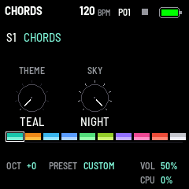

GLO once more opens DEBUG, the two cores' timings (section 11).

### HALL, TAPE, ECHO (FX)

The effect's three pages, a lake under the terricons showing what it does (0.33): section 7.

### ARP (ARP, 0.34)

 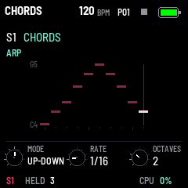

The selected synth track's arpeggiator: the notes held (the keys, MIDI in, and the track's own steps) played one after
another, in time. ARP shows its page, ARP again its second; ARP is lit while the selected track's arp is on (on
another page). The knobs are small, in the bottom band; under them the track and the notes its arp holds (HOLD while
it keeps them).

| Page | K1 | K2 | K3 |
| --- | --- | --- | --- |
| ARP | MODE | RATE | OCTAVES |
| ARP 2 | GATE | HOLD | — |

- **MODE:** OFF; UP, low to high; DOWN; UP-DOWN, up and back, the ends once; RANDOM (not the same note twice running,
  while there is another); AS PLAYED, in the order the keys went down; CHORD, all its notes together each time.
- **RATE:** a note value at the tempo, as ECHO's: 1/32 to 1/2, triplets (T) and dotted (.). A 16th as it comes.
- **OCTAVES:** 1 to 4: the notes, then again an octave up, and so on.
- **GATE:** each note's length, 5 to 100 % of RATE (50 as it comes); at 100 % they run into one another.
- **HOLD:** the notes go on once the keys are let go, until the next keys come.

The page draws the arp as a ladder: its notes across in the order it plays them (CHORD: a column an octave, its notes
stacked), each as high as its pitch, in the track's colour, the note playing white. With nothing held it shows a
chord's shape (the last one played, or C major), dim.

**In time.** While the song plays, the arp's notes fall on the song's grid: 24 ticks a quarter note, as MIDI clock
(a MIDI clock in's too); keys played between wait for the next of RATE's. Stopped, the first note sounds at once and
the rest follow at the tempo.

**What it plays.** The keys and MIDI in on the selected track, and the track's steps: a chord on a step is held for
the step's length and played through the arp (record a chord, the arp plays it). Recording records the keys, not the
arp's notes. The arp's notes go out over MIDI on the track's channel, as the sequencer's do; the keys' own notes do
not while it is on.

**Saved with the sound.** The arp is part of the track's sound: SAVE keeps it, a user preset holds it, and ALGO keeps
it when it changes the engine; a factory preset, and any sound from before 0.34, has it OFF. A drum track has none.

---

## 5. The sequencer

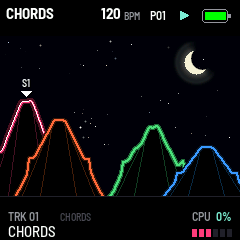

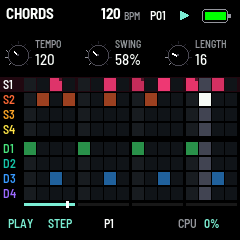

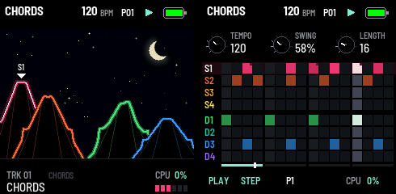

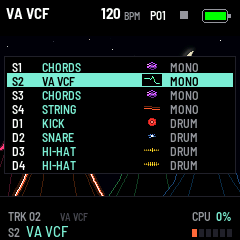

Eight tracks play together. The four synth tracks, S1 to S4, each have their own engine, OSC knobs and voices
(sections 6 and 8). The four drum tracks, D1 to D4, each play a drum of Plaits' (a kick, a snare or a hi-hat, in two
models each) with six knobs of their own (section 4), in a voice of their own: they never take the synth tracks'
four. Every track has its own steps
and LENGTH, all at one TEMPO and SWING, through the one effect; each synth track has its own envelope and LFO (0.37; a drum
decays on its own, by its DECAY). SELECT picks the track the page, the keys and step mode are for; the keys play
along with the sequencer. A track has 64 steps in four pages of 16, as many as its LENGTH (1 to 64): tracks of
different lengths drift against each other and meet again (a polymeter). A step holds a note or a chord of up to
four, its velocity and its length.

A fresh FM-1's tracks are a lead (WAVESHAPE), a bass (VA VCF), chords (CHORDS) and a pluck (STRING), one voice each,
and a kit: a kick (D1), a snare (D2), a closed hi-hat (D3) and an open one (D4).

### HOME: the terricons (0.28) under the sky (0.29)

HOME opens on the song at a glance: a ridge of eight terricons, a track each, S1 at the left to D4 at the right on
one ground line, each in a colour of its own (rose, orange, amber, yellow, green, teal, blue, violet, left to
right). They are spoil heaps as the Donbas has them (since 0.29): their tops flat, a terrace on each slope, gullies
running down them. Each has its own height and place; where they overlap, the lower one stands in front.

 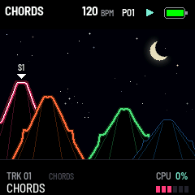

- **The sky** (GLO's SCREEN, K2 SKY; 0.29): by DAY a light blue sky (0.30.2; 0.30.1 had none), its sun at the top
  right flaring at each kick, three soft clouds drifting slowly across at the tempo's pace, low over the heaps' tops
  (each its own shape, see-through, bright on top and greyer below, thinning at their edges, the sun showing through),
  the heaps dark (their tracks' colours only on their rims, a little brighter as they sound; 0.29.1); by NIGHT, as it
  comes (since 0.30.2), a clean crescent moon at the top right (its dark part the sky's, its glow by its lit edge),
  its light shimmering, its glow breathing, a ripple of light going out from it now and again, and stars that come
  out, shine a few seconds, fade and come out again elsewhere, twinkling, the brighter ones flashing at each hi-hat;
  now and then a shooting star (0.29.1); OFF, black as before. With a sky the page moves on its own, about 20 times a
  second while all is quiet.

- **A track with no step on** in the pattern has no terricon; its place stays empty, so every one keeps its place.
- **A quiet track's terricon** is its colour, dim and still. **A sounding one** lives: its slopes bend with the
  track's own sound (measured before the mix, followed with an attack and a release), a glow under its line
  brighter the louder. How it moves comes from its engine: a kick a strong quick bulge, its peak jumping up as it
  hits, a snare a sharper one, a hi-hat small quick teeth, a bass big smooth waves, a pad slow ones.
- **A muted track's terricon** (or one silenced by another's solo, the mixer) is grey and still.
- **The selected track's terricon** is thicker, white at its core, with a marker and its name over its top; its
  level, six segments in its colour, is at the right of the bottom band (0.29.1), under CPU, their edges in line.
- **The scene is taller** (0.29.2): it goes on under the page, 28 rows more, so the heaps stand bigger, and HOME's
  bottom band is half as high, its sound's name smaller. SELECT picks another.
- **The bottom band** (32 pixels high since 0.29.2): TRK 03 and its engine, MUTE / SOLO, CPU; its sound's name (a * once changed
  after its preset). A moment's message (TEMPO 120, PATTERN ...) takes its place, and while counting in IN 4 .. 1.
- **K1 TEMPO** (30 to 300 BPM, a step is a 16th; the song's), **K2 SWING** (the selected track's, 50 % straight to
  75 %; with SEQ held, the pattern's, every track's), **K3 LENGTH** (the selected track's, 1 to 64 steps), K4 the
  pattern, as before; their values show in the bottom band as they turn.

The terricons redraw on their own while anything sounds, about 30 times a second (10 while the sound takes 75 % or
more); still, nothing moves. In 0.27 HOME showed eight concentric rings, and before it the selected track as a
piano roll; step mode (SEQ) shows every track's steps.

A list over the page (the tracks, the patterns, a preset's slots, the presets' browser) stops it until the list
goes.

### Step mode (SEQ)

SEQ turns step mode on (SEQ lit), from any page: the screen shows every track, the 16 white keys are the steps of
the page shown, and the keys no longer play. SEQ again shows the selected track alone (0.31, below), and a third
time turns step mode off and goes back to the page it was pressed on; HOME turns it off and shows HOME's
terricons; another page's button (LFO, ENV, FX, GLO) turns it off and opens that page.

The screen shows every track then, as the keys do, under TEMPO, SWING and LENGTH (small knobs at the page's top
since 0.29; the engine in the header, the bottom band one line of state since 0.30.1): eight rows, 15 pixels apart
(0.30.1: bigger, on down to the screen's foot), S1 to S4 then D1 to D4, named at the left, each
in its track's colour, its terricon's on HOME (since 0.28), the selected one on a ground of its colour; the 16 steps
of the page shown across (the white keys), in beats of four. A step on is lit in its track's colour, brighter the
harder it plays (the selected track's brightest); a notch at its corner marks a chord, a mark at its foot its locks
(0.35); past a track's LENGTH, a dot. Each track's step playing lights (tracks of different lengths drift apart), a
note flashing white as it begins. A held step is framed in white. The pages are under the rows, as on HOME.

| Do | What happens |
| --- | --- |
| Tap a white key | Its step on (with the last note or chord you played: C4 before any; on a drum track, the drum's own note), or off |
| Hold a white key, turn K1 | Its notes up or down, a semitone a detent |
| Hold a white key, turn K2 / K3 | Its velocity / its length in steps (1 to 64) |
| The first eight black keys | Track S1, S2, S3, S4, D1, D2, D3, D4 |
| OCT- / OCT+ | The page before / after |
| Hold SEQ, tap a white key | That step is the last: the LENGTH (step mode stays on) |

The keys' lights show the selected track's steps: a step on lit, an empty one mid, one past the LENGTH dim, the
step playing the other way round (an empty one lights, one on goes out); the black keys show the tracks: the
selected one lit, one with voices mid (a drum track always), one without dim, each flashing as it plays a note.

### The track alone (SEQ again, 0.31)

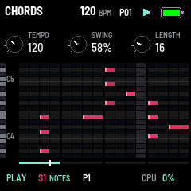 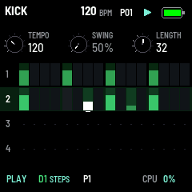

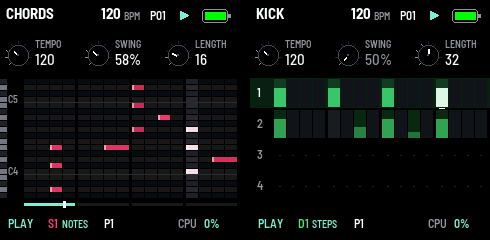

SEQ pressed again in step mode shows the selected track alone, all of the screen its own, under the same knobs
(TEMPO, SWING, LENGTH); the bottom band names it, with NOTES or STEPS. The keys work as in step mode: a white key
puts its step on or off, held with K1 to K3 its notes, velocity and length; OCT- / OCT+ the pages; the black keys 1
to 8 another track (the view following it, notes or steps); SEQ held and a white key the LENGTH. SEQ a third time
goes back to the page step mode was entered from; HOME to the terricons.

- **A synth track (S1 to S4): its notes as a piano roll.** The page's 16 steps across, in beats of four, as the
  white keys; 20 semitones up, the black keys' rows darker, a keyboard at the left with each C named and a line
  under it. A note is a bar in the track's colour on its row, as long as its length in steps (a note held from the
  page before goes on into this one), brighter the harder it plays, its start lit; a chord, its notes one over the
  other. The roll follows the track's notes: it stays while they fit, and centres them when one goes out of it
  (more than 20 semitones apart: the page's notes); a note still out of it is a mark at the roll's top or foot.
  The step playing has its column lighter, its notes flashing as they begin; the step held is framed in white; past
  the LENGTH the columns are darker. The pages are under it, as in step mode.
- **A drum track (D1 to D4): all its steps.** Its 64 steps a page a row, 1 to 4 at the left, the page on the white
  keys on a ground of the track's colour. A step on is its colour, with its velocity as a bar up from its foot (the
  harder, the higher); the step playing lights, a note flashing white, a mark under it; past the LENGTH, a dot.

### Step recording (REC)

Stopped, REC starts step recording (PLAY red, REC blinking): the notes you play go into the steps one after the
other, from the first step of the page shown. A chord (keys held together, up to four) or a single note fills one
step, at its velocity. SELECT moves to another step (to leave one as it is). REC again ends it; PLAY goes on
recording, live.

### Live recording (REC while playing)

While the sequencer plays, REC records what you play into the selected track as it goes round (PLAY red, REC
lighting on each beat, a red dot in the header; HOME's terricons show it sounding). REC again stops recording and the sequencer plays on; stopping (PLAY) ends it too. REC while stopped and
then PLAY records from the first step (with METRONOME at COUNT, after a bar of clicks: IN 4 .. IN 1 in the bottom
band; nothing plays or records meanwhile but a note in the last half step, which goes to the first).

- **Each note goes to the nearest step** (always quantized): to the step playing if you played it in the first half
  of that step, or to the next one if in the second half. That next step does not play it again this time round:
  you have just heard it.
- **Its velocity** is the key's (or GLO's fixed one); **its length**, how long you hold the key, in steps (at least
  one). Notes played within 60 ms of each other make a chord on one step, up to four.
- **A step's first note replaces** what the step held; every other step stays as it was. Play over a loop to change
  some notes and keep the rest.
- **On a drum track** any key records the drum's hit.
- **MIDI in's notes** (a keyboard over USB or TRS) are recorded the same way, with their own velocity and length.
- **Hold SEQ while recording to erase:** the selected track's steps are switched off as the sequencer passes them
  (ERASE in the bottom band), for as long as SEQ is held. Letting SEQ go then does not switch step mode.
- SELECT picks the track as usual, so you can record one track, then the next, without stopping.

**The metronome:** GLO's K3 METRONOME at REC (as it comes) clicks on each quarter note while recording live, the
bar's first higher and louder; at COUNT it also counts a bar in when recording starts from a stop (REC, then PLAY;
not while following a MIDI clock); at OFF it stays silent. The click is mixed after the effect, at MASTER's volume.
It is saved with the settings.

**Clearing a track:** hold SEQ and press REC: the selected track's steps all go off (its length stays), playing or
stopped. SEQ let go then does not switch step mode.

### Parameter locks (EDIT, 0.35)

A step can have its own value of a track's knobs: a parameter lock. It holds from the step until the track's next step
that plays or locks; a step that plays without locks brings the track's own knobs back, and so does stopping.

- **LOCK mode:** tap EDIT (lit while on). On every page the white keys are then the selected track's steps (OCT- and
  OCT+ the other pages of 16), the black keys the tracks, as in step mode. A step locked or held is lit, one with a
  note half lit. The bottom band shows the 16 steps (a note in the track's colour, a lock marked white) and LOCK.
- **A lock:** hold a step (or several) and turn a knob: each held step locks it, from its own lock or the track's
  value. While held, the step's locks are heard and the page shows them: a locked knob's name and value in the theme's
  colour, marked. Let go, the knobs show the track's own again.
- **What can lock:** OSC's three knobs; a synth track's ENV (ATTACK, DECAY, RELEASE) and MOD's LFO RATE and LFO DEPTH
  (0.37); a drum track's DRUM page (TUNE and its two knobs) and SHAPE; the mixer's VOL and SEND (SEND locked on a step
  throws it into the effect). Elsewhere (LFO DEST, the effect, the arp, the sound's other pages) LOCK NOT ON THIS PAGE:
  those are not locked.
- **A lock without a note:** hold a step that is off and lock it: it changes the sound as the song passes it, without
  a note (a pad's long chord moving under it).
- **Recording the knobs:** in LOCK mode, recording live (REC while playing; REC shows HOME: open the knob's page), a
  knob turned locks the step playing, heard at once: a move over several steps locks each of them.
- **Clearing:** hold EDIT and press a step's white key: its locks go (LOCK mode stays as it was). A step taken off in
  step mode loses its locks too; clearing a track (SEQ held, REC) clears its locks.

In step mode a step with locks has a white mark at its foot. A pattern holds up to 512 locks, saved with it; patterns
saved before 0.35 load as they were, with none.

### Playing (PLAY)

PLAY starts from step 1; PLAY again stops, and every note it holds ends. PLAY's green LED flashes on each beat,
longer on the first of each bar. A step's note lasts its length in steps, ending an eighth of a step before the
next. SWING delays every second step: 50 % is straight, about 67 % a triplet feel, 75 % the most. Each track has its
own (K2 on the selected one), or follows the pattern's (SEQ held and K2 sets that one and makes every track follow
it): a swung hi-hat over a straight kick, say.

### Patterns (HOME held, K4)

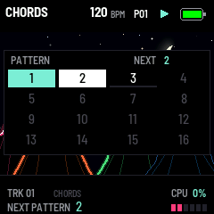

There are sixteen patterns. Each has its own steps, LENGTH for each track, and SWING. The sound of the tracks (their
engines, knobs and voices) and the TEMPO are the song's: the same whichever pattern plays.

- **HOME held** shows the sixteen for as long as it is held, and the white keys light them: the one playing lit,
  the next one blinking, one with steps mid, an empty one dim. A white key picks that pattern. (HOME tapped still
  changes the page, on its release.)
- **K4** picks the pattern after the one playing (or the one queued), or before it, and shows the sixteen for a
  moment.
- **A MIDI program change** 0 to 15 (any channel, USB or TRS) picks pattern 1 to 16.
- **A chain (0.41):** HOME held, white keys one after another: those patterns in that order, round, each coming in
  at the end of the one before. Each pattern once (0.41.1): a key pressed again is not added, so a pattern picked
  twice is still just that pattern. Stopped, it starts from its first at once; playing, its first is queued. The
  grid's bottom line shows CHAIN and its patterns, the one playing lit. **Stopping ends it** (CHAIN OFF; 0.41.1): the
  pattern it was on stays. One pattern picked by hand (HOME and one key, K4, a program change) ends it too; to end it
  and keep playing as you are, HOME and the key of the pattern playing. A chain is not saved.
- **Copy, paste, clear (0.40)**, as on Elektron's machines, with HOME held: **OCT-** copies the pattern playing (COPY
  and its number at the grid's top), **OCT+** pastes the copy into the pattern playing, **REC** clears it (every
  step, lock, LENGTH and SWING as an empty pattern's). To copy one pattern into another: copy it, pick the other, paste.
  A paste or a clear is heard at once, playing or not (the tracks go on from where they are), and is saved as any
  edit. The octave, REC and the page stay as they were. The copy is kept in the flash across a restart (PASTE then
  no longer knows its number); PASTE NOTHING COPIED if there is none. There is no undo.

Stopped, the pattern changes at once. Playing, the one picked is queued (NEXT, blinking) and comes in at the end
of the pattern playing: when its longest track with steps comes round (a pattern with no steps: every 16 steps).
Every track then starts from its first step. Picking the one playing again takes the queued one back.

A pattern you leave is saved by itself, edits and all; while playing it is written into the flash a little at a
time, without a gap in the sound, and the next one comes in once it is (a moment, at most a pattern later). An
empty pattern starts with every track 16 steps long.

### Timing and MIDI

The sequencer's notes land within half a millisecond (a 24-sample grid), not on the 5.8 ms audio blocks. Over USB
MIDI it sends each track's notes on its channel (S1 to S4 on 1 to 4, D1 to D4 on 5 to 8, as the keys of the track
selected) and, while it plays, Start, 24 clocks a quarter note and Stop.
A MIDI clock coming in (USB or TRS) leads it: Start, Continue and Stop start and stop it, its tempo shows on SEQ
(MIDI CLOCK), swing still applies; half a second without a clock, the sequencer's own TEMPO takes over again.

SAVE keeps the pattern playing too, its locks with it (section 9). The pattern 0.17 and before saved becomes pattern 1, with its
tempo (0.15's, of one track, as S1's; 0.16's with the drum tracks empty).

---

## 6. The engines

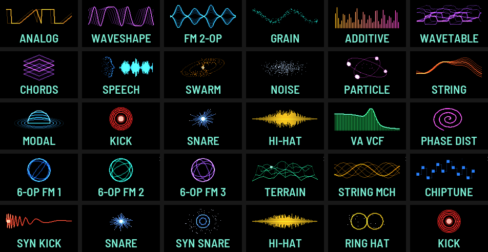

ALGO steps the selected track's engine through all 24 engines of Plaits, in Plaits' own order: its first sixteen,
then the eight its firmware 1.2 added. K1 is TIMBRE, K2 MORPH, K3 HARMONICS; their screen labels describe the engine (FM 2-OP: INDEX, FEEDBACK, RATIO;
WAVESHAPE: FOLD, ASYMMETRY, CURVE). What they do, engine by engine, is
below. On a drum track ALGO steps among six drums alone, each with its DRUM and SHAPE knobs (section 4):

| Drum | What it is |
| --- | --- |
| KICK | Plaits' analog kick: a pulse into a resonant filter, its pitch pushed by PUNCH and SWEEP, then DRIVE |
| SYN KICK | Plaits' second, digital kick (its AUX out): a sine with a pitch envelope (PUNCH its depth, SWEEP its time) and dirt (DRIVE) |
| SNARE | Plaits' analog snare: the drum's modes and the snares' noise (SNAPPY) |
| SYN SNARE | Plaits' digital snare: an FM drum (TONE: its FM) and noise |
| HI-HAT | Plaits' metallic hi-hat: six square waves through a band-pass and a swing VCA |
| RING HAT | Plaits' second hi-hat: ring-modulated noise, a linear VCA |

| # | Engine | TIMBRE (K1) | MORPH (K2) | HARMONICS (K3) |
| --- | --- | --- | --- | --- |
| 1 | ANALOG | Square: narrow pulse, square, then hard-sync formants | Saw: triangle to saw, then a widening notch | Detune between the two waves |
| 2 | WAVESHAPE | Wavefolding | Asymmetry | The shaper's curve |
| 3 | FM 2-OP | Modulation index | Feedback: rough one way, chaotic the other | Frequency ratio |
| 4 | GRAIN | Formant frequency | Formant width and shape | Ratio between the two formants |
| 5 | ADDITIVE | Which harmonic is strongest | Shape of the bumps, wide to narrow | Number of bumps in the spectrum |
| 6 | WAVETABLE | Row in the table | Column | Bank: four smooth, then four stepped |
| 7 | CHORDS | Inversion and transposition | Waveform: string and organ, then a wavetable | Chord type |
| 8 | SPEECH | Species: the formants, from giant to chipmunk | Phoneme, or the part of the word | Vowels (formant, SAM, LPC), then banks of words |
| 9 | SWARM | Density of the grains | Grain length and overlap | Pitch randomness |
| 10 | NOISE | Clock frequency | Resonance | Filter: low-pass, band-pass, high-pass |
| 11 | PARTICLE | Density of the particles | Filter: an all-pass reverb, then resonant band-pass | Frequency randomness |
| 12 | STRING | Brightness of the excitation | Decay | Inharmonicity, the material |
| 13 | MODAL | Brightness of the excitation | Decay | Inharmonicity, the material |
| 14 | KICK | Brightness | Decay | Attack sharpness and overdrive |
| 15 | SNARE | Balance of the drum's modes | Decay | Tone against noise |
| 16 | HI-HAT | High-pass cutoff | Decay | Metal against noise |
| 17 | VA VCF | Filter cutoff | Waveform and sub level | Resonance and character, smooth to harsh |
| 18 | PHASE DIST | Amount of distortion | Its asymmetry | Its frequency |
| 19 | 6-OP FM 1 | Brightness (the modulators' level) | Envelopes and modulation, stretched | One of 32 patches: basses and synths |
| 20 | 6-OP FM 2 | Brightness | Envelopes and modulation, stretched | One of 32 patches: keys, plucks, percussion |
| 21 | 6-OP FM 3 | Brightness | Envelopes and modulation, stretched | One of 32 patches: organs, pads, strings, brass |
| 22 | TERRAIN | Radius of the path | Offset of the path | One of eight terrains, blended |
| 23 | STRING MCH | Chorus and filter | Waveform | Chord |
| 24 | CHIPTUNE | Arpeggio, or the chord's inversion | Pulse width and sync | Chord |

### How a note plays each engine

Plaits has a trigger input; in Terykons a note is the trigger, in three ways:

- **Held:** most engines simply sound for as long as the note is held, and the envelope shapes them.
- **Struck, then sounding on:** STRING and MODAL are struck when a note begins and kept ringing while it is held
  (as on Plaits with nothing in its trigger input), then ring out with the envelope's release.
- **A gate:** BASS DRUM, SNARE and HI-HAT are struck by each note and decay on their own; the 6-OP FM banks play
  their patch's envelopes, which release when the key is let go; SPEECH speaks a word with each note when HARMONICS
  is among the word banks; PARTICLE starts afresh with each note.

The velocity is also Plaits' accent: the engines that strike strike harder and brighter. Plaits' second output
(AUX) is not used. The engines run as on Plaits, 12 samples at a time, at the FM-1's 44.1 kHz.

### Levels

The engines were brought to about the same loudness at their defaults (measured: the level while a note is held,
a drum by its peak). Some change level with a knob by nature: SWARM, PARTICLE and NOISE with their density or
clock, MODAL with TIMBRE (its exciter thins to a sparse crackle below the default), the 6-OP FM patches from one to
the next.

---

## 7. The effect (FX)

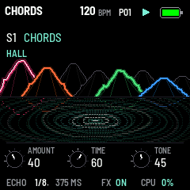  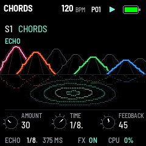

Terykons' effect (0.32) is an echo in time with the tempo and the reverb of Mutable Instruments Beads, both
coloured by Beads' media: digital, vintage or tape. The tracks go into it by their SEND (the mixer, section 4), in
mono; what each does not send goes past it, dry. The echoes go on into the reverb; the reverb plays in stereo.
Until 0.31 the effect was all of Beads (its grains, their delay, FREEZE and SEED); its reverb, its tape's wow and
flutter and its 8-bit colour are what stay.

FX shows its pages, and pressed again the next: HALL, TAPE, ECHO, round. From another page, FX goes back to the one
shown last. Their three knobs are small, in the bottom band (0.33, as the mixer's); under them ECHO's time as a note
value and in milliseconds at the tempo, whether the effect is on, and CPU.

**On and off:** each AMOUNT is a send: how much goes into the reverb, or into the echo. With both at 0 nothing goes
in; what is in the reverb and the echoes rings out, and once it has died away the effect is off and costs nothing
(as it starts). FX is lit while it runs (on another page).

### The lake (0.33)

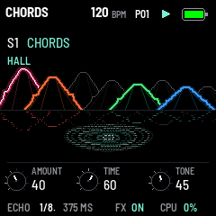

The effect's pages show what it does: a lake at night under HOME's terricons (section 5), smaller, each track's in
its colour, moving with its sound as on HOME, mirrored in the water (a track with no step a grey heap). What is on
the water is the effect's:

- **A drop:** a note going into the effect (its track's SEND above 0) falls into the water, a white ring as bright as
  it is loud. A chord is one drop.
- **The echoes:** ECHO's repeats follow it, TIME apart, thicker rings in the theme's colour, the first as strong as
  AMOUNT sends, each next weaker by FEEDBACK.
- **The tail:** HALL's reverb ripples on as long as it sounds, fainter rings, more of them as DIFFUSE is higher,
  brighter as TONE is, carried further as TIME is longer.
- **MOD** sways the rings, and the reflections while the water moves. **QUALITY** shows as the medium: VINTAGE's rings
  on every other row, CLEAN TAPE's wavering, DIRTY TAPE's broken up over a grain.

The page's own part is the brighter: the tail on HALL, the echoes on ECHO, both on TAPE. With nothing going in the
water is still, and nothing is redrawn.

### HALL

| Knob | Parameter | What it does |
| --- | --- | --- |
| K1 | AMOUNT | How much goes into the reverb (Beads' REVERB curve); the mixer's RETURN is the same knob |
| K2 | TIME | How long the tail lasts: a small room at 0, a long hall at 100 |
| K3 | TONE | The tail's colour: dark at 0, bright at 100 |

### TAPE

| Knob | Parameter | What it does |
| --- | --- | --- |
| K1 | QUALITY | The echo's and the reverb's medium (below) |
| K2 | DIFFUSE | How the reflections blur: distinct at 0, a smooth wash at 100 |
| K3 | MOD | The tail's slow movement: still at 0, Beads' shimmer around 60, a chorus-like drift at 100 |

| QUALITY | The sound |
| --- | --- |
| DIGITAL | Clean |
| VINTAGE | 12 bits: a little grit in the echoes and the reverb |
| CLEAN TAPE | Saturated, a little wow and flutter; the echoes and the tail darker |
| DIRTY TAPE | 8-bit μ-law, saturated, the full wow and flutter: hiss and wobble |

QUALITY colours only the effect: the dry sound stays clean. Off DIGITAL the reverb is longer and darker, as on Beads.

### ECHO

| Knob | Parameter | What it does |
| --- | --- | --- |
| K1 | AMOUNT | How much goes into the echo |
| K2 | TIME | The echo's time as a note value at the tempo: 1/32, 1/16T, 1/16, 1/8T, 1/16., 1/8, 1/4T, 1/8., 1/4, 1/2T, 1/4., 1/2 (T a triplet, . dotted) |
| K3 | FEEDBACK | How many repeats: one at 0, on and on near 100 (on the tapes a little over: the saturation holds them) |

The echo follows the tempo (a MIDI clock in too). Its line holds 1.1 s: a time longer than that, at a slow tempo,
is halved until it fits, still in time. Turning TIME glides to the new time, as a tape does, its pitch bending on the
way. Its repeats darken as they go round, more on the tapes.

The effect starts with both AMOUNTs at 0 (off), TIME 40, TONE 55, DIGITAL, DIFFUSE 70, MOD 60, ECHO at 1/8. and
FEEDBACK 35.

---

## 8. Voices and velocity

**VOICES** (GLO, K1): the FM-1 has four voices for the synth tracks, each its own engine, shared out among them:
each track none (OFF), one (MONO) or up to four (POLY), four in all. Each track starts with one, so at first none
is free. Turning a track's VOICES up takes a free voice, else one from a track that has more than one (the one with
the most); never another track's last voice, which would leave it silent. With none to take, VOICES stays as it was
and says NO VOICE FREE: turn another track down first (to OFF to free its voice). Turning a track down leaves the
voice free. GLO shows each track's voices and those free above the knobs. A track at OFF plays nothing (its steps
still go out on MIDI); HOME's bottom band says NO VOICE in red while it is selected. Each drum track has a voice of
its own besides (VOICES shows DRUM): a new hit strikes it afresh.

- **POLY:** each note takes one of the track's voices: a free one first, else the one let go longest ago, else the
  oldest held. The same note played again takes its own voice back.
- **MONO:** one voice, the last note wins; let go of it and the voice goes back to the note still held, without a
  new attack (legato); let go of the last one and it releases.

Changing VOICES lets go of every note. All the voices add up through a soft limiter, so a loud chord bends rather
than clips.

**VELOCITY** (GLO, K2): ON, the keys play as they land; OFF, every key plays at 100, and sends 100 over MIDI too.
MIDI coming in keeps its own velocity either way. The velocity sets a voice's level and how hard it strikes.

The keys' pressure goes out over MIDI as polyphonic aftertouch; it doesn't change the sound (yet).

---

## 9. Saving

### The presets' browser (PRESET)

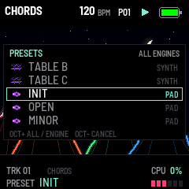

Turning PRESET opens the browser over the page, on the sound playing. It lists every sound the selected track can
play, engine after engine in ALGO's order: each engine's four factory sounds, then the user's saved on it (a drum
track: its six drums' only). Each row shows the engine's icon, the sound's name (a factory one's up to 16
characters) and its kind: SYNTH, BASS, LEAD, PAD, PLUCK, KEYS, DRUM, FX, or USER.

- **Turning PRESET** moves to the next sound (round the list) and plays it at once: past an engine's last, the next
  engine's first, the engine changing with it. Only the track's sound changes: its steps, its length, the mixer
  (VOL, SEND, mute, solo), the tempo and the other tracks stay, and the sequencer goes on. Nothing is written to the
  flash.
- **OCT+** shows the current engine's sounds alone, and again all.
- **OCT-** puts the sound back as it was when the browser opened, and closes it.
- It closes 3 s after the last turn, or as a page's button is pressed or another track is chosen, keeping the
  sound chosen. ALGO (an engine by hand) closes it too.
- **A sound changed after its preset** (a knob turned) keeps the preset's name with a * (until 0.27 it read
  CUSTOM). Loading a preset again, or saving the sound, clears it.

**Sound presets (0.21).** ALGO chooses the engine; PRESET scrolls through its four factory starting points and
user presets saved for the same engine and track kind. A sound preset stores its main engine knobs, all additional controls (the full edited FM patch when applicable),
OUTPUT, and on a dedicated drum TUNE, DECAY, TONE and all SHAPE controls; a synth sound also its ARP (0.34) and its ENV
and LFO (0.37). Track assignment, VOICES, FX, tempo and patterns are outside the preset. Synth-track drums and dedicated drums have separate preset lists because their
controls differ. Factory starting points still need musical refinement by listening on the FM-1.

Hold SAVE for 300 ms to open the 64-slot grid. OCT-/+ chooses one of four pages of sixteen; the sixteen white keys
save the selected track's sound to the corresponding slot, **replacing it if occupied**. Lit slots contain a
preset; S/D marks its track kind. Names are USER 01 through USER 64. Release SAVE to close. Holding SAVE without
choosing a key closes without saving settings. The modifier keys never play or record notes.

PRESET QUEUED means the new sound is still in RAM: stop playback and release the notes, then wait for
**PRESET SAVED** before powering off. The pending queue holds eight different slots; QUEUE FULL asks you to stop before saving another.
Flash writing waits until no voice is active; a write may briefly interrupt
an effect tail. PRESET FAILED leaves SAVE lit; tap SAVE to retry. A firmware update preserves the bank; 0.21 presets import automatically, retaining their original copy. Preset
saving is independent of saving the track settings: tap SAVE as well to keep the current track's sound at boot.

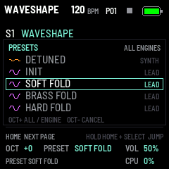
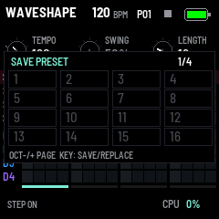

SAVE stores the octave, each track's engine (a drum track's drum) and OSC values (a drum's DRUM and SHAPE), the synth
tracks' VOICES, the MOD
and ENV values, VELOCITY, the effect's eight knobs and QUALITY, the TEMPO and the pattern you are on, and that
pattern's steps; Terykons starts with them at the next power-on (settings saved before 0.16 give S1 their sound,
the other tracks start fresh, one voice each; settings saved by 0.16 load with the kit as it comes; by 0.18, with
TUNE at the note and SHAPE as Plaits made the drum sound from its HARMONICS). Writing the
settings stops the sound for a moment, so SAVE writes them only when they changed: save them while the sequencer is
stopped. A pattern is written without a gap (section 5), and saved by itself when you leave it; edits to the one
you are on that neither SAVE nor leaving it saved are lost at power-off. Settings saved by 0.31 or before load
with their REVERB as HALL's AMOUNT and the effect's other knobs at rest (0.32). SAVE is lit while something has changed and isn't stored yet. A tap on SAVE
lights the white keys one after another, first to last, then all of them for a moment (0.31), whatever page is
shown; SAVE FAILED lights none. A firmware update
keeps them (settings saved by 0.12 load with the effect at rest).

---

## 10. MIDI and USB audio

**MIDI in,** over USB and the TRS jack: notes play the selected track (a drum track too), with their velocity, from
any channel; or, with GLO's MIDI page's IN at CHANNELS (0.39), each track the notes on its channel (section 4). A
program change 0 to 15, on any channel, picks pattern 1 to 16 (section 5). Recording live records the notes that play
the selected track. The last message shows at the bottom of the screen. CC, pitch bend and aftertouch in are not
used.

**MIDI out,** over USB (the FM-1 has no MIDI out jack), on each track's channel (GLO's MIDI page; at first S1 to S4 on
1 to 4, D1 to D4 on 5 to 8; OFF: none): the keys' notes (the selected track's), their velocity and their pressure
(polyphonic aftertouch), the arp's notes, and the sequencer's notes; while it plays by its own tempo, MIDI Start,
clock (24 a quarter note) and Stop (CLOCK OUT). No MIDI thru, no CC out.

**MIDI clock in** (USB or TRS, CLOCK IN) leads the sequencer: section 5.

**USB audio:** the FM-1 is also a USB sound card, 16-bit at 44.1 kHz, no driver needed. GLO's USB page (0.42) has
two ways:

- **STEREO** (as it comes): a computer records the mix (inputs 1-2, at MASTER), and plays its own sound through the
  FM-1's speaker and headphones, at MASTER.
- **MULTI**: a computer records the mix on inputs 1-2 and each of the eight tracks on an input of its own: S1 on 3,
  S2 on 4, S3 on 5, S4 on 6, D1 on 7, D2 on 8, D3 on 9, D4 on 10 (a multitrack in a DAW). A track's input is its
  voices after its fader (VOL), as it plays in the mix, mono, without the effect (that is on 1-2 alone) and without
  its PAN (0.43: the mix on 1-2 has it; in the DAW a track is placed again on its own). All ten come
  at a fixed level whatever MASTER says: 6 dB under what a full MASTER gives the speaker (0.42.2; a hot drum stays
  clean, where 0.42.0's tracks hit the limiter), on the computer's clock (0.42.1, below), about 7 ms later than in
  STEREO. They carry the FM-1 alone: the computer's own playback through the FM-1 and the metronome's click are heard
  but not sent (0.42.2; a DAW monitoring its inputs feeds nothing back), and the computer's sound comes through the
  FM-1 as in STEREO.

**Recording into a DAW: MULTI.** The FM-1's sound runs on its own clock, about 44,120 Hz by a Mac's (0.045 % fast).
STEREO sends it so: a DAW that records from the FM-1 and plays through another device drifts from it and breaks
the recording every few seconds (clicks, gaps). MULTI (0.42.1) converts it to the computer's own clock, exactly
44,100 frames a second by the cable, so the DAW can play through any device: the Mac's speakers, headphones, or the
FM-1 (its output runs on the computer's clock too). It keeps a deeper buffer as well, so a busy FM-1 (the CPU high,
the effect on) records without a hold. The DAW's sample rate must be 44100 (the FM-1 has 44.1 kHz alone): with an
output device at 48 kHz, Ableton refuses ("do not share a valid sample rate"); set that device to 44.1 kHz in
macOS's Audio MIDI Setup, or choose the FM-1 as the output.

**On a Mac, the DAW's Mic Mode must be Standard.** macOS gives each app a Mic Mode of its own: Standard, Voice
Isolation or Wide Spectrum, in Control Center while the app is recording (its orange microphone in the menu bar).
Voice Isolation works on an interface's first two inputs alone and takes a synth for noise: inputs 3 to 10 record
cleanly while 1-2 come as near silence, scraps and clicks. Nothing on the FM-1's side changes that: set the DAW's
Mic Mode to Standard (start the app again if it holds on). The app needs the microphone permission too (System
Settings, Privacy & Security, Microphone).

In Ableton Live, say: Preferences, Audio: Input Device Terykons FM-1, Output Device the one to hear it through
(Terykons FM-1 too, or the Mac's), Sample Rate 44100; in Input Config the inputs 1/2 as a stereo pair and 3 to 10 as mono; then an audio track for
each, its input the track's (3 for S1 and so on), armed. Monitoring the FM-1's inputs in the DAW while hearing the
FM-1 itself plays them twice: leave monitoring off, or MASTER down. MULTI costs the FM-1 nothing it can hear: the
work for the computer runs on its second core, after each block's sound is done (0.42.2; 0.42.1 spent 16 % of the
first core on it, and a heavy patch with the effect then shed voices and broke up).

Ten channels and the output at 44.1 kHz fill most of the full-speed USB the FM-1 has: they come in whole (checked on
an FM-1 and macOS, every frame, the output playing); computers other than a Mac are not tested yet. Checked too: the
ten inputs read alike through CoreAudio's audio unit, a raw HAL IOProc and a stereo client, in Ableton Live 11 (its
Mic Mode Standard) and in iZotope RX.

Terykons has no Bluetooth or WiFi.

---

## 11. CPU and its limits

CPU (bottom right) is the smoothed share of each audio block's time used by rendering. Terykons uses both of
the FM-1's cores. With the effect off, the sounding Plaits voices are split between them. With the effect on,
it runs on the second core, a 24-sample chunk behind the voices, while the first renders them (0.32: its reverb and
echo alone, about a quarter of what all of Beads took); the voices go to whichever core has room. Nothing is added to the latency,
and the sound is the same on one core or two. GLO five times opens DEBUG (after GLO, MIDI, USB and SCREEN), where K1 selects one/two-core processing and K2
resets peaks and counters. These debug choices are temporary.

Off (both AMOUNTs at 0, its tails died away), the effect is bypassed and costs nothing. If a block takes over 90% of its
time, Terykons takes a voice: a synth track's before a drum's; one let go first, else the oldest. It fades out over 3 ms, so there is no click, and
the last voice sounding is never taken (nor MONO's one voice). The average CPU display can stay below 90% even when
short peaks trigger protection. A released voice that is silent costs nothing.

DEBUG's PEAK, OVER, SHED and XRUN distinguish peaks, protection cuts and missed audio deadlines. The footer
CPU turns red once a block is late and remains red until power-on. Fewer VOICES, a lighter engine, or the effect
off can reduce load. Two cores increase capacity but do not guarantee four voices and four drums at every FX
setting.

See [DEBUG controls and fields](https://github.com/gravkode/gravkode-fm1/blob/main/terykons/docs/DUAL_CORE_DEBUG.md) and [measured hardware results](https://github.com/gravkode/gravkode-fm1/blob/main/terykons/docs/DUAL_CORE_RESULTS.md).

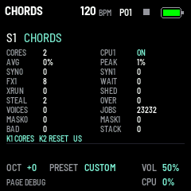

---

## 12. Troubleshooting

**No sound:** turn MASTER up; some engines are quiet by their settings (MODAL and SWARM with TIMBRE low, NOISE and
PARTICLE thin); a drum or a 6-OP FM patch may simply have decayed.

**A crackle:** see section 11.

**The sound goes on after the keys are let go:** the effect: a long HALL TIME, or ECHO's FEEDBACK high. Both
AMOUNTs at 0 stop anything new going in; what is in rings out.

**The effect does nothing:** both AMOUNTs at 0, or the track's SEND at 0 (the mixer, section 4).

**The installer doesn't find the FM-1:** a data cable, other MIDI apps and browser tabs closed, Chrome or Edge.
Started but out of reach over USB: hold REC while switching on (update mode), then install.

**The keys play no notes:** step mode is on (SEQ lit): press SEQ until it goes out (or HOME).

**The sequencer plays nothing:** the steps past the LENGTH don't play (they show as dots); a MIDI clock coming in
leads it (MIDI CLOCK on SEQ): start it from there.

**The knobs or keys read wrong:** hold OCT- and OCT+ while switching on, for the panel's setup.

---

## 13. Credits and licences

- Terykons is built on **fm1-base** (Charles Vestal) and **felucca-bsp** (Leo Kuroshita, Hügelton Instruments),
  MPL-2.0.
- Its sound engines are **Mutable Instruments Plaits**, its reverb and tape colours **Mutable Instruments Beads**, and their library
  **stmlib**, by Émilie Gillet, under the MIT License; the notices are in the source
  (`terykons/vendor/plaits/LICENSE`, `terykons/vendor/beads/LICENSE`) and on the site's front page.
- The fonts are Barlow (SIL Open Font License).

M-VAVE and FM-1 are trademarks of their owners. Terykons is not affiliated with M-VAVE or Mutable Instruments.
