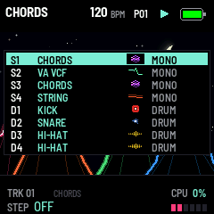

# Terykons 0.29.2 — a flat sky, a taller scene

Package: `terykons-0.29.2.fwsc`, identity `FM-1_73002902`. After 0.29.1 (`a5f070a`: the night alive).

 

Asked for after 0.29.1 ran on the FM-1:

- **The sky is one colour,** its top one (0.29 lightened it towards the ground): a deep blue by day, near black at
  night.
- **HOME's scene is taller.** It goes on under the page, 28 rows more, down to 32 pixels from the screen's foot; the
  heaps are a fifth bigger (wider and taller), the ground lower.
- **HOME's bottom band is half as high** (32 pixels instead of 60): TRK, the engine, MUTE / SOLO / FREEZE and CPU
  on its first line; the sound's name, smaller (S instead of M), and the level at the right on its second. A
  moment's message and the count-in take the second line, smaller too. Every other page's band is as it was.

**In the code:** the screen's canvas holds 144 rows at most, so HOME's scene is drawn twice a frame, into the page
(144 rows) and into its foot (`HOME_FOOT`, 28 rows under it, the same scene `draw_terricons(-144, ...)`); the sky
takes its offset (`draw_sky(base, dy, ...)`). The band starts at `HOME_BAND_Y`.

Validation on 29 October 2026:

- All 18 simulator scenarios pass, and the screenshot script.
- The pictures are new: HOME by day and at night, the lists and the browser over it, GLO's version, both GIFs.
- The sequencer, pattern bank, preset and 1018 bit-exact dual-core tests pass.
- Device build/compiler checks pass: image **422036 B** (+208), RAM **92568 / 98304 B** (**5736 B free**), pool
  **332968 / 344064 B**. Package **611496 B**; no soft-double helpers, unsafe instruction patterns or direct register
  access introduced.

Package SHA-256: `fb9d33c3b0be755481ea970eea2d7ea2230cfc828f206eee4cf1deee494081d6`.

Not yet installed on the FM-1.
